<!-- Generated by integration/db-schema-reference.ts - do not edit. Run: bun run db:docs -->

# `account`

Source: [src/lib/auth/schema.ts](../../../src/lib/auth/schema.ts)

## Columns

| Column                         | Kind               | Database type              | Nullable | Default     | References                   |
| ------------------------------ | ------------------ | -------------------------- | -------- | ----------- | ---------------------------- |
| `id`                           | UUID (primary key) | `uuid`                     | No       | –           | –                            |
| `linking_key`                  | Free text          | `text`                     | Yes      | –           | –                            |
| `role`                         | Free text          | `text`                     | No       | –           | –                            |
| `name`                         | Free text          | `text`                     | Yes      | –           | –                            |
| `lightning_address`            | Free text          | `text`                     | Yes      | –           | –                            |
| `lightning_address_verified`   | Boolean            | `boolean`                  | No       | –           | –                            |
| `forum_laws_dismissed`         | Boolean            | `boolean`                  | No       | –           | –                            |
| `created_at`                   | Date/time          | `timestamp with time zone` | No       | –           | –                            |
| `rules_agreed_at`              | Date/time          | `timestamp with time zone` | Yes      | –           | –                            |
| `nostr_pubkey`                 | Free text          | `text`                     | Yes      | –           | –                            |
| `nostr_nsec_ciphertext`        | Binary             | `bytea`                    | Yes      | –           | –                            |
| `nostr_kek_id`                 | Integer            | `integer`                  | No       | `1`         | –                            |
| `nostr_key_custody`            | ENUM               | `text`                     | No       | `custodial` | –                            |
| `nostr_key_created_at`         | Date/time          | `timestamp with time zone` | Yes      | –           | –                            |
| `view_key`                     | Free text          | `text`                     | Yes      | –           | –                            |
| `is_platform`                  | Boolean            | `boolean`                  | No       | `false`     | –                            |
| `name_skipped_at`              | Date/time          | `timestamp with time zone` | Yes      | –           | –                            |
| `lightning_address_skipped_at` | Date/time          | `timestamp with time zone` | Yes      | –           | –                            |
| `profile_message_id`           | UUID (foreign key) | `uuid`                     | Yes      | –           | [`message`.`id`](message.md) |
| `location`                     | Free text          | `text`                     | Yes      | –           | –                            |
| `notification_level`           | ENUM               | `text`                     | No       | `all`       | –                            |
| `amount_unit`                  | ENUM               | `text`                     | No       | `btc`       | –                            |
| `locale`                       | ENUM               | `text`                     | Yes      | –           | –                            |
| `fiat`                         | ENUM               | `text`                     | Yes      | –           | –                            |
| `username`                     | Free text          | `text`                     | Yes      | –           | –                            |
| `session_refused`              | Boolean            | `boolean`                  | No       | `false`     | –                            |
| `wallet_required`              | Boolean            | `boolean`                  | No       | `false`     | –                            |
| `wallet_backup_seen_at`        | Date/time          | `timestamp with time zone` | Yes      | –           | –                            |
| `staff_tag`                    | Free text          | `text`                     | Yes      | –           | –                            |

## Indexes

| Columns              | Unique | Where                                                                 |
| -------------------- | ------ | --------------------------------------------------------------------- |
| `(expression)`       | Yes    | `(lightning_address IS NOT NULL)`                                     |
| `(expression)`       | Yes    | `((username IS NOT NULL) AND (TRIM(BOTH FROM username) <> ''::text))` |
| `id`                 | Yes    | –                                                                     |
| `is_platform`        | Yes    | `is_platform`                                                         |
| `linking_key`        | Yes    | –                                                                     |
| `nostr_pubkey`       | Yes    | `(nostr_pubkey IS NOT NULL)`                                          |
| `profile_message_id` | Yes    | `(profile_message_id IS NOT NULL)`                                    |
| `view_key`           | Yes    | `(view_key IS NOT NULL)`                                              |

## Referenced by

| Table                   | Column                 | Points to |
| ----------------------- | ---------------------- | --------- |
| `account_image`         | `account_id`           | `id`      |
| `address_verification`  | `account_id`           | `id`      |
| `api_log`               | `account_id`           | `id`      |
| `auth_session`          | `account_id`           | `id`      |
| `contact`               | `account_id`           | `id`      |
| `conversation`          | `account_a`            | `id`      |
| `conversation`          | `account_b`            | `id`      |
| `conversation_message`  | `actor_account_id`     | `id`      |
| `conversation_message`  | `sender_account_id`    | `id`      |
| `conversation_read`     | `account_id`           | `id`      |
| `funding_grant`         | `account_id`           | `id`      |
| `funding_grant`         | `decided_by`           | `id`      |
| `member_habit`          | `account_id`           | `id`      |
| `member_habit_comment`  | `account_id`           | `id`      |
| `message`               | `account_id`           | `id`      |
| `message`               | `shop_account_id`      | `id`      |
| `notification`          | `actor_account_id`     | `id`      |
| `notification`          | `recipient_account_id` | `id`      |
| `passkey_credential`    | `account_id`           | `id`      |
| `passkey_renew_attempt` | `account_id`           | `id`      |
| `pos_charge`            | `account_id`           | `id`      |
| `push_outbox`           | `account_id`           | `id`      |
| `push_subscription`     | `account_id`           | `id`      |
| `trust_edge`            | `actor_id`             | `id`      |
| `trust_edge`            | `subject_id`           | `id`      |

## Relations

```mermaid
erDiagram
    "account" }o--o| "message" : "profile_message_id"
    "account_image" }o--|| "account" : "account_id"
    "address_verification" |o--|| "account" : "account_id"
    "api_log" }o--o| "account" : "account_id"
    "auth_session" }o--|| "account" : "account_id"
    "contact" }o--|| "account" : "account_id"
    "conversation" }o--o| "account" : "account_b"
    "conversation" }o--|| "account" : "account_a"
    "conversation_message" }o--o| "account" : "actor_account_id"
    "conversation_message" }o--o| "account" : "sender_account_id"
    "conversation_read" }o--|| "account" : "account_id"
    "funding_grant" |o--|| "account" : "account_id"
    "funding_grant" }o--o| "account" : "decided_by"
    "member_habit" }o--|| "account" : "account_id"
    "member_habit_comment" }o--|| "account" : "account_id"
    "message" }o--o| "account" : "account_id"
    "message" }o--o| "account" : "shop_account_id"
    "notification" }o--|| "account" : "actor_account_id"
    "notification" }o--|| "account" : "recipient_account_id"
    "passkey_credential" }o--|| "account" : "account_id"
    "passkey_renew_attempt" }o--|| "account" : "account_id"
    "pos_charge" }o--|| "account" : "account_id"
    "push_outbox" }o--|| "account" : "account_id"
    "push_subscription" }o--|| "account" : "account_id"
    "trust_edge" }o--|| "account" : "actor_id"
    "trust_edge" }o--|| "account" : "subject_id"
```

