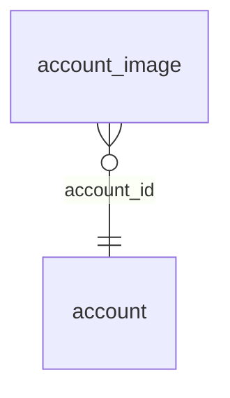

<!-- Generated by integration/db-schema-reference.ts - do not edit. Run: bun run db:docs -->

# `account_image`

Source: [src/lib/banner-store.ts](../../../src/lib/banner-store.ts)

## Columns

| Column         | Kind               | Database type | Nullable | Default | References                   |
| -------------- | ------------------ | ------------- | -------- | ------- | ---------------------------- |
| `account_id`   | UUID (primary key) | `uuid`        | No       | –       | [`account`.`id`](account.md) |
| `slot`         | ENUM (primary key) | `text`        | No       | –       | –                            |
| `content_type` | Free text          | `text`        | No       | –       | –                            |
| `data`         | Binary             | `bytea`       | No       | –       | –                            |

## Indexes

| Columns              | Unique | Where |
| -------------------- | ------ | ----- |
| `account_id`, `slot` | Yes    | –     |

## Referenced by

None.

## Relations

