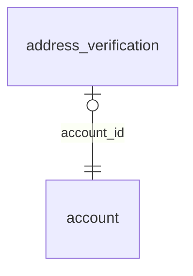

<!-- Generated by integration/db-schema-reference.ts - do not edit. Run: bun run db:docs -->

# `address_verification`

Source: [src/lib/auth/schema.ts](../../../src/lib/auth/schema.ts)

## Columns

| Column       | Kind               | Database type              | Nullable | Default | References                   |
| ------------ | ------------------ | -------------------------- | -------- | ------- | ---------------------------- |
| `account_id` | UUID (primary key) | `uuid`                     | No       | –       | [`account`.`id`](account.md) |
| `address`    | Free text          | `text`                     | No       | –       | –                            |
| `nonce`      | Free text          | `text`                     | No       | –       | –                            |
| `created_at` | Date/time          | `timestamp with time zone` | No       | –       | –                            |

## Indexes

| Columns      | Unique | Where |
| ------------ | ------ | ----- |
| `account_id` | Yes    | –     |

## Referenced by

None.

## Relations

