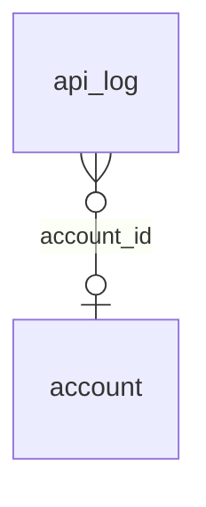

<!-- Generated by integration/db-schema-reference.ts - do not edit. Run: bun run db:docs -->

# `api_log`

Source: [src/lib/api-log.ts](../../../src/lib/api-log.ts)

## Columns

| Column            | Kind               | Database type              | Nullable | Default | References                   |
| ----------------- | ------------------ | -------------------------- | -------- | ------- | ---------------------------- |
| `id`              | UUID (primary key) | `uuid`                     | No       | –       | –                            |
| `created_at`      | Date/time          | `timestamp with time zone` | No       | –       | –                            |
| `method`          | Free text          | `text`                     | No       | –       | –                            |
| `path`            | Free text          | `text`                     | No       | –       | –                            |
| `status`          | Integer            | `integer`                  | No       | –       | –                            |
| `ms`              | Integer            | `integer`                  | No       | –       | –                            |
| `account_id`      | UUID (foreign key) | `uuid`                     | Yes      | –       | [`account`.`id`](account.md) |
| `auth_kind`       | ENUM               | `text`                     | No       | –       | –                            |
| `client_ip`       | Free text          | `text`                     | Yes      | –       | –                            |
| `client_country`  | Free text          | `text`                     | Yes      | –       | –                            |
| `cf_ray`          | Free text          | `text`                     | Yes      | –       | –                            |
| `user_agent`      | Free text          | `text`                     | Yes      | –       | –                            |
| `accept_language` | Free text          | `text`                     | Yes      | –       | –                            |
| `origin`          | Free text          | `text`                     | Yes      | –       | –                            |

## Indexes

| Columns                          | Unique | Where |
| -------------------------------- | ------ | ----- |
| `account_id`, `created_at`, `id` | No     | –     |
| `created_at`, `id`               | No     | –     |
| `id`                             | Yes    | –     |

## Referenced by

None.

## Relations

