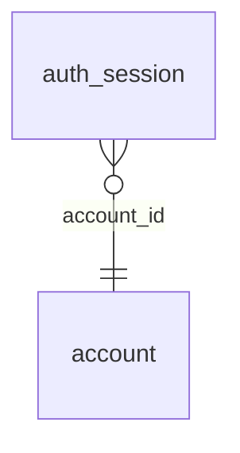

<!-- Generated by integration/db-schema-reference.ts - do not edit. Run: bun run db:docs -->

# `auth_session`

Source: [src/lib/auth/schema.ts](../../../src/lib/auth/schema.ts)

## Columns

| Column       | Kind                    | Database type              | Nullable | Default | References                   |
| ------------ | ----------------------- | -------------------------- | -------- | ------- | ---------------------------- |
| `token`      | Free text (primary key) | `text`                     | No       | –       | –                            |
| `account_id` | UUID (foreign key)      | `uuid`                     | No       | –       | [`account`.`id`](account.md) |
| `created_at` | Date/time               | `timestamp with time zone` | No       | –       | –                            |

## Indexes

| Columns | Unique | Where |
| ------- | ------ | ----- |
| `token` | Yes    | –     |

## Referenced by

None.

## Relations

