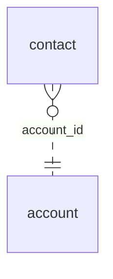

<!-- Generated by integration/db-schema-reference.ts - do not edit. Run: bun run db:docs -->

# `contact`

Source: [src/lib/contact-store.ts](../../../src/lib/contact-store.ts)

## Columns

| Column       | Kind               | Database type              | Nullable | Default | References                   |
| ------------ | ------------------ | -------------------------- | -------- | ------- | ---------------------------- |
| `id`         | UUID (primary key) | `uuid`                     | No       | –       | –                            |
| `account_id` | UUID (foreign key) | `uuid`                     | No       | –       | [`account`.`id`](account.md) |
| `name`       | Free text          | `text`                     | No       | –       | –                            |
| `text`       | Free text          | `text`                     | No       | –       | –                            |
| `created_at` | Date/time          | `timestamp with time zone` | No       | –       | –                            |

## Indexes

| Columns            | Unique | Where | Definition                                                                                     |
| ------------------ | ------ | ----- | ---------------------------------------------------------------------------------------------- |
| `created_at`, `id` | No     | –     | `CREATE INDEX contact_created_at_idx ON public.contact USING btree (created_at DESC, id DESC)` |
| `id`               | Yes    | –     | `CREATE UNIQUE INDEX contact_pkey ON public.contact USING btree (id)`                          |

## Referenced by

None.

## Relations

