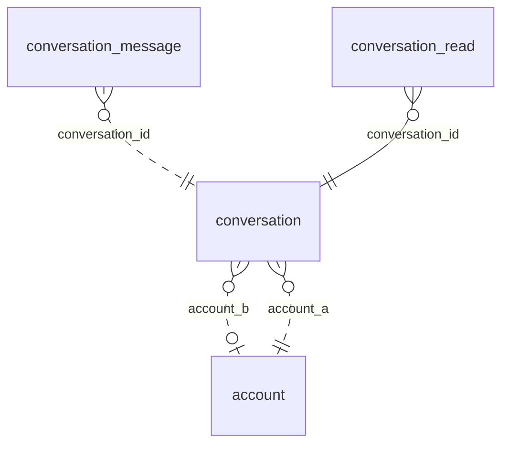

<!-- Generated by integration/db-schema-reference.ts - do not edit. Run: bun run db:docs -->

# `conversation`

Source: [src/lib/conversation-store.ts](../../../src/lib/conversation-store.ts)

## Columns

| Column               | Kind               | Database type              | Nullable | Default | References                   |
| -------------------- | ------------------ | -------------------------- | -------- | ------- | ---------------------------- |
| `id`                 | UUID (primary key) | `uuid`                     | No       | –       | –                            |
| `kind`               | ENUM               | `text`                     | No       | –       | –                            |
| `account_a`          | UUID (foreign key) | `uuid`                     | No       | –       | [`account`.`id`](account.md) |
| `account_b`          | UUID (foreign key) | `uuid`                     | Yes      | –       | [`account`.`id`](account.md) |
| `counterpart_pubkey` | Free text          | `text`                     | Yes      | –       | –                            |
| `created_at`         | Date/time          | `timestamp with time zone` | No       | –       | –                            |
| `last_message_at`    | Date/time          | `timestamp with time zone` | No       | –       | –                            |

## Indexes

| Columns                           | Unique | Where                              | Definition                                                                                                                                                  |
| --------------------------------- | ------ | ---------------------------------- | ----------------------------------------------------------------------------------------------------------------------------------------------------------- |
| `account_a`                       | Yes    | `(kind = 'member_platform'::text)` | `CREATE UNIQUE INDEX conversation_member_platform_uidx ON public.conversation USING btree (account_a) WHERE (kind = 'member_platform'::text)`               |
| `account_a`, `account_b`          | Yes    | `(kind = 'member_member'::text)`   | `CREATE UNIQUE INDEX conversation_member_member_uidx ON public.conversation USING btree (account_a, account_b) WHERE (kind = 'member_member'::text)`        |
| `account_a`, `counterpart_pubkey` | Yes    | `(kind = 'member_damus'::text)`    | `CREATE UNIQUE INDEX conversation_member_damus_uidx ON public.conversation USING btree (account_a, counterpart_pubkey) WHERE (kind = 'member_damus'::text)` |
| `id`                              | Yes    | –                                  | `CREATE UNIQUE INDEX conversation_pkey ON public.conversation USING btree (id)`                                                                             |
| `kind`                            | Yes    | `(kind = 'moderator_group'::text)` | `CREATE UNIQUE INDEX conversation_moderator_group_uidx ON public.conversation USING btree (kind) WHERE (kind = 'moderator_group'::text)`                    |
| `last_message_at`, `id`           | No     | –                                  | `CREATE INDEX conversation_last_message_at_idx ON public.conversation USING btree (last_message_at DESC, id DESC)`                                          |

## Referenced by

| Table                  | Column            | Points to |
| ---------------------- | ----------------- | --------- |
| `conversation_message` | `conversation_id` | `id`      |
| `conversation_read`    | `conversation_id` | `id`      |

## Relations

