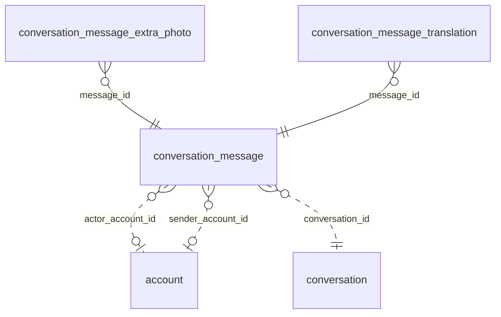

<!-- Generated by integration/db-schema-reference.ts - do not edit. Run: bun run db:docs -->

# `conversation_message`

Source: [src/lib/conversation-store.ts](../../../src/lib/conversation-store.ts)

## Columns

| Column                | Kind               | Database type              | Nullable | Default | References                             |
| --------------------- | ------------------ | -------------------------- | -------- | ------- | -------------------------------------- |
| `id`                  | UUID (primary key) | `uuid`                     | No       | –       | –                                      |
| `conversation_id`     | UUID (foreign key) | `uuid`                     | No       | –       | [`conversation`.`id`](conversation.md) |
| `text`                | Free text          | `text`                     | No       | –       | –                                      |
| `created_at`          | Date/time          | `timestamp with time zone` | No       | –       | –                                      |
| `sender_account_id`   | UUID (foreign key) | `uuid`                     | Yes      | –       | [`account`.`id`](account.md)           |
| `sender_pubkey`       | Free text          | `text`                     | Yes      | –       | –                                      |
| `name`                | Free text          | `text`                     | No       | –       | –                                      |
| `event_id`            | Free text          | `text`                     | Yes      | –       | –                                      |
| `nostr_publish_state` | Free text          | `text`                     | No       | –       | –                                      |
| `nostr_event`         | JSON               | `jsonb`                    | Yes      | –       | –                                      |
| `claimed_until`       | Date/time          | `timestamp with time zone` | Yes      | –       | –                                      |
| `sats`                | Integer            | `bigint`                   | No       | `0`     | –                                      |
| `fiat_usd`            | Decimal            | `numeric(20,2)`            | Yes      | –       | –                                      |
| `fiat_chf`            | Decimal            | `numeric(20,2)`            | Yes      | –       | –                                      |
| `fiat_eur`            | Decimal            | `numeric(20,2)`            | Yes      | –       | –                                      |
| `fiat_php`            | Decimal            | `numeric(20,2)`            | Yes      | –       | –                                      |
| `actor_account_id`    | UUID (foreign key) | `uuid`                     | Yes      | –       | [`account`.`id`](account.md)           |
| `actor_name`          | Free text          | `text`                     | No       | `''`    | –                                      |
| `gift_for_message_id` | UUID               | `uuid`                     | Yes      | –       | –                                      |
| `mentions`            | JSON               | `jsonb`                    | No       | `[]`    | –                                      |
| `photo`               | Binary             | `bytea`                    | Yes      | –       | –                                      |
| `photo_content_type`  | Free text          | `text`                     | Yes      | –       | –                                      |
| `photo_taken_at`      | Free text          | `text`                     | Yes      | –       | –                                      |

## Indexes

| Columns                               | Unique | Where                                                                           | Definition                                                                                                                                                                                                         |
| ------------------------------------- | ------ | ------------------------------------------------------------------------------- | ------------------------------------------------------------------------------------------------------------------------------------------------------------------------------------------------------------------ |
| `conversation_id`, `created_at`       | No     | `((gift_for_message_id IS NULL) AND (sats > 0) AND (actor_account_id IS NULL))` | `CREATE INDEX conversation_message_gift_unlinked_idx ON public.conversation_message USING btree (conversation_id, created_at) WHERE ((gift_for_message_id IS NULL) AND (sats > 0) AND (actor_account_id IS NULL))` |
| `conversation_id`, `created_at`, `id` | No     | –                                                                               | `CREATE INDEX conversation_message_conversation_id_idx ON public.conversation_message USING btree (conversation_id, created_at, id)`                                                                               |
| `event_id`                            | Yes    | `(event_id IS NOT NULL)`                                                        | `CREATE UNIQUE INDEX conversation_message_event_id_uidx ON public.conversation_message USING btree (event_id) WHERE (event_id IS NOT NULL)`                                                                        |
| `id`                                  | No     | `((nostr_event IS NOT NULL) AND (jsonb_typeof(nostr_event) = 'string'::text))`  | `CREATE INDEX conversation_message_nostr_event_unrepaired_idx ON public.conversation_message USING btree (id) WHERE ((nostr_event IS NOT NULL) AND (jsonb_typeof(nostr_event) = 'string'::text))`                  |
| `id`                                  | Yes    | –                                                                               | `CREATE UNIQUE INDEX conversation_message_pkey ON public.conversation_message USING btree (id)`                                                                                                                    |

## Referenced by

| Table                              | Column       | Points to |
| ---------------------------------- | ------------ | --------- |
| `conversation_message_extra_photo` | `message_id` | `id`      |
| `conversation_message_translation` | `message_id` | `id`      |

## Relations

