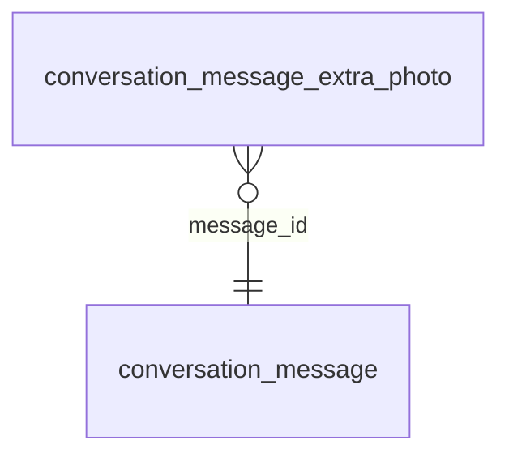

<!-- Generated by integration/db-schema-reference.ts - do not edit. Run: bun run db:docs -->

# `conversation_message_extra_photo`

Source: [src/lib/conversation-store.ts](../../../src/lib/conversation-store.ts)

## Columns

| Column               | Kind                  | Database type | Nullable | Default | References                                             |
| -------------------- | --------------------- | ------------- | -------- | ------- | ------------------------------------------------------ |
| `message_id`         | UUID (primary key)    | `uuid`        | No       | –       | [`conversation_message`.`id`](conversation_message.md) |
| `idx`                | Integer (primary key) | `smallint`    | No       | –       | –                                                      |
| `photo`              | Binary                | `bytea`       | No       | –       | –                                                      |
| `photo_content_type` | Free text             | `text`        | No       | –       | –                                                      |
| `photo_taken_at`     | Free text             | `text`        | Yes      | –       | –                                                      |

## Indexes

| Columns             | Unique | Where | Definition                                                                                                                           |
| ------------------- | ------ | ----- | ------------------------------------------------------------------------------------------------------------------------------------ |
| `message_id`, `idx` | Yes    | –     | `CREATE UNIQUE INDEX conversation_message_extra_photo_pkey ON public.conversation_message_extra_photo USING btree (message_id, idx)` |

## Referenced by

None.

## Relations

