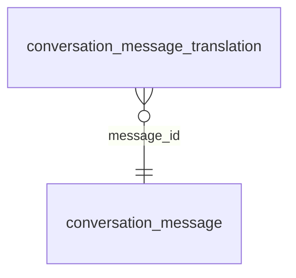

<!-- Generated by integration/db-schema-reference.ts - do not edit. Run: bun run db:docs -->

# `conversation_message_translation`

Source: [src/lib/conversation-store.ts](../../../src/lib/conversation-store.ts)

## Columns

| Column            | Kind                    | Database type              | Nullable | Default | References                                             |
| ----------------- | ----------------------- | -------------------------- | -------- | ------- | ------------------------------------------------------ |
| `message_id`      | UUID (primary key)      | `uuid`                     | No       | –       | [`conversation_message`.`id`](conversation_message.md) |
| `target_lang`     | Free text (primary key) | `text`                     | No       | –       | –                                                      |
| `source_sha256`   | Free text               | `text`                     | No       | –       | –                                                      |
| `translated_text` | Free text               | `text`                     | No       | –       | –                                                      |
| `created_at`      | Date/time               | `timestamp with time zone` | No       | –       | –                                                      |

## Indexes

| Columns                     | Unique | Where |
| --------------------------- | ------ | ----- |
| `message_id`, `target_lang` | Yes    | –     |

## Referenced by

None.

## Relations

