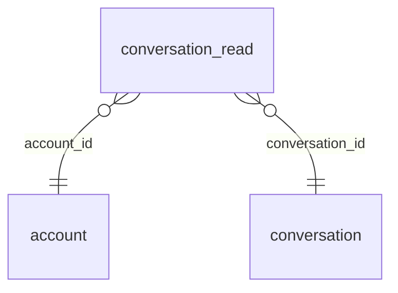

<!-- Generated by integration/db-schema-reference.ts - do not edit. Run: bun run db:docs -->

# `conversation_read`

Source: [src/lib/conversation-store.ts](../../../src/lib/conversation-store.ts)

## Columns

| Column            | Kind               | Database type              | Nullable | Default | References                             |
| ----------------- | ------------------ | -------------------------- | -------- | ------- | -------------------------------------- |
| `account_id`      | UUID (primary key) | `uuid`                     | No       | –       | [`account`.`id`](account.md)           |
| `conversation_id` | UUID (primary key) | `uuid`                     | No       | –       | [`conversation`.`id`](conversation.md) |
| `last_read_at`    | Date/time          | `timestamp with time zone` | No       | –       | –                                      |

## Indexes

| Columns                         | Unique | Where | Definition                                                                                                         |
| ------------------------------- | ------ | ----- | ------------------------------------------------------------------------------------------------------------------ |
| `account_id`, `conversation_id` | Yes    | –     | `CREATE UNIQUE INDEX conversation_read_pkey ON public.conversation_read USING btree (account_id, conversation_id)` |
| `conversation_id`               | No     | –     | `CREATE INDEX conversation_read_conversation_id_idx ON public.conversation_read USING btree (conversation_id)`     |

## Referenced by

None.

## Relations

