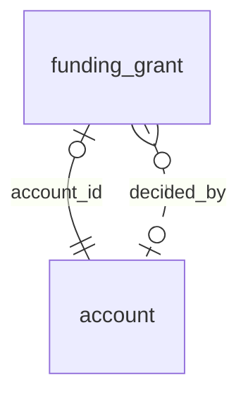

<!-- Generated by integration/db-schema-reference.ts - do not edit. Run: bun run db:docs -->

# `funding_grant`

Source: [src/lib/funding-store.ts](../../../src/lib/funding-store.ts)

## Columns

| Column           | Kind               | Database type              | Nullable | Default | References                   |
| ---------------- | ------------------ | -------------------------- | -------- | ------- | ---------------------------- |
| `account_id`     | UUID (primary key) | `uuid`                     | No       | –       | [`account`.`id`](account.md) |
| `status`         | ENUM               | `text`                     | No       | –       | –                            |
| `applied_at`     | Date/time          | `timestamp with time zone` | No       | –       | –                            |
| `decided_at`     | Date/time          | `timestamp with time zone` | Yes      | –       | –                            |
| `decided_by`     | UUID (foreign key) | `uuid`                     | Yes      | –       | [`account`.`id`](account.md) |
| `trial_utc_date` | Date/time          | `date`                     | Yes      | –       | –                            |
| `admitted_at`    | Date/time          | `timestamp with time zone` | Yes      | –       | –                            |
| `note`           | Free text          | `text`                     | Yes      | –       | –                            |

## Indexes

| Columns      | Unique | Where | Definition                                                                                |
| ------------ | ------ | ----- | ----------------------------------------------------------------------------------------- |
| `account_id` | Yes    | –     | `CREATE UNIQUE INDEX funding_grant_pkey ON public.funding_grant USING btree (account_id)` |

## Referenced by

None.

## Relations

