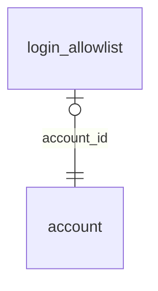

<!-- Generated by integration/db-schema-reference.ts - do not edit. Run: bun run db:docs -->

# `login_allowlist`

Source: [src/lib/login-gate-store.ts](../../../src/lib/login-gate-store.ts)

## Columns

| Column       | Kind               | Database type              | Nullable | Default | References                   |
| ------------ | ------------------ | -------------------------- | -------- | ------- | ---------------------------- |
| `account_id` | UUID (primary key) | `uuid`                     | No       | –       | [`account`.`id`](account.md) |
| `created_at` | Date/time          | `timestamp with time zone` | No       | –       | –                            |

## Indexes

| Columns      | Unique | Where | Definition                                                                                    |
| ------------ | ------ | ----- | --------------------------------------------------------------------------------------------- |
| `account_id` | Yes    | –     | `CREATE UNIQUE INDEX login_allowlist_pkey ON public.login_allowlist USING btree (account_id)` |

## Referenced by

None.

## Relations

