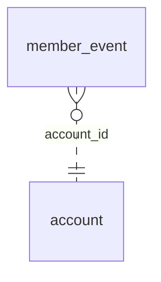

<!-- Generated by integration/db-schema-reference.ts - do not edit. Run: bun run db:docs -->

# `member_event`

Source: [src/lib/member-event-store.ts](../../../src/lib/member-event-store.ts)

## Columns

| Column        | Kind               | Database type              | Nullable | Default | References                   |
| ------------- | ------------------ | -------------------------- | -------- | ------- | ---------------------------- |
| `id`          | UUID (primary key) | `uuid`                     | No       | –       | –                            |
| `account_id`  | UUID (foreign key) | `uuid`                     | No       | –       | [`account`.`id`](account.md) |
| `name`        | Free text          | `text`                     | No       | –       | –                            |
| `at`          | Date/time          | `timestamp with time zone` | No       | –       | –                            |
| `path`        | Free text          | `text`                     | Yes      | –       | –                            |
| `props`       | JSON               | `jsonb`                    | No       | `{}`    | –                            |
| `received_at` | Date/time          | `timestamp with time zone` | No       | –       | –                            |

## Indexes

| Columns                  | Unique | Where | Definition                                                                                                   |
| ------------------------ | ------ | ----- | ------------------------------------------------------------------------------------------------------------ |
| `account_id`, `at`, `id` | No     | –     | `CREATE INDEX member_event_account_at_idx ON public.member_event USING btree (account_id, at DESC, id DESC)` |
| `id`                     | Yes    | –     | `CREATE UNIQUE INDEX member_event_pkey ON public.member_event USING btree (id)`                              |

## Referenced by

None.

## Relations

