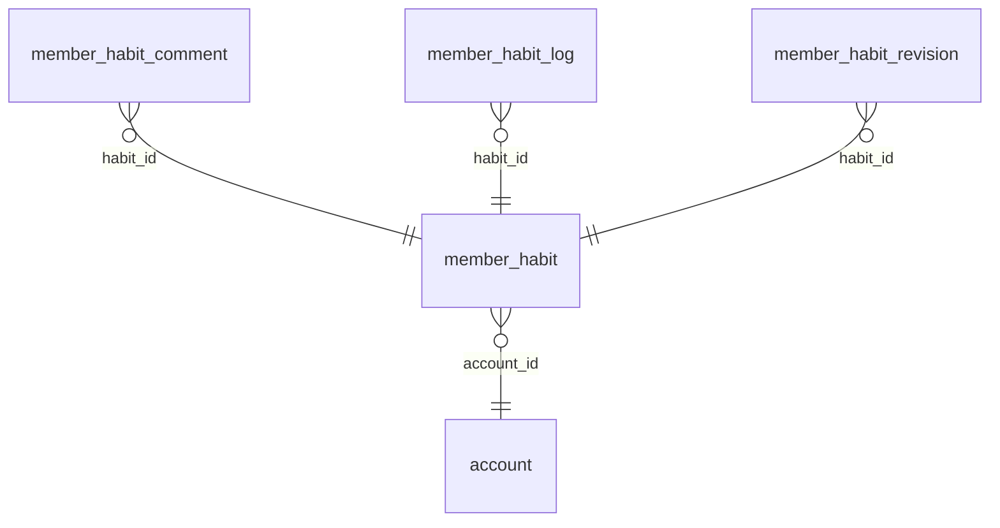

<!-- Generated by integration/db-schema-reference.ts - do not edit. Run: bun run db:docs -->

# `member_habit`

Source: [src/lib/member-habit-store.ts](../../../src/lib/member-habit-store.ts)

## Columns

| Column         | Kind               | Database type | Nullable | Default | References                   |
| -------------- | ------------------ | ------------- | -------- | ------- | ---------------------------- |
| `id`           | UUID (primary key) | `uuid`        | No       | –       | –                            |
| `account_id`   | UUID (foreign key) | `uuid`        | No       | –       | [`account`.`id`](account.md) |
| `owner_name`   | Free text          | `text`        | No       | –       | –                            |
| `role`         | Free text          | `text`        | No       | –       | –                            |
| `name`         | Free text          | `text`        | No       | –       | –                            |
| `description`  | Free text          | `text`        | No       | –       | –                            |
| `notes`        | Free text          | `text`        | No       | –       | –                            |
| `cadence`      | ENUM               | `text`        | No       | –       | –                            |
| `time_zone`    | Free text          | `text`        | No       | –       | –                            |
| `first_period` | Free text          | `text`        | No       | –       | –                            |
| `last_period`  | Free text          | `text`        | Yes      | –       | –                            |

## Indexes

| Columns | Unique | Where | Definition                                                                      |
| ------- | ------ | ----- | ------------------------------------------------------------------------------- |
| `id`    | Yes    | –     | `CREATE UNIQUE INDEX member_habit_pkey ON public.member_habit USING btree (id)` |

## Referenced by

| Table                   | Column     | Points to |
| ----------------------- | ---------- | --------- |
| `member_habit_comment`  | `habit_id` | `id`      |
| `member_habit_log`      | `habit_id` | `id`      |
| `member_habit_revision` | `habit_id` | `id`      |

## Relations

