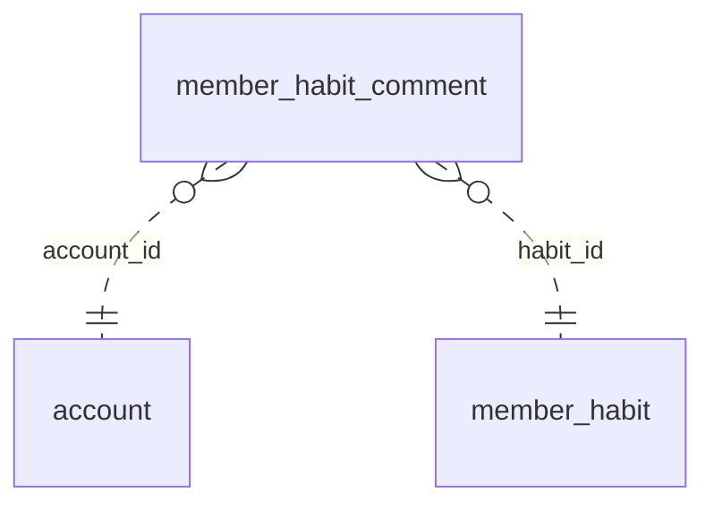

<!-- Generated by integration/db-schema-reference.ts - do not edit. Run: bun run db:docs -->

# `member_habit_comment`

Source: [src/lib/member-habit-store.ts](../../../src/lib/member-habit-store.ts)

## Columns

| Column       | Kind               | Database type      | Nullable | Default | References                             |
| ------------ | ------------------ | ------------------ | -------- | ------- | -------------------------------------- |
| `id`         | UUID (primary key) | `uuid`             | No       | –       | –                                      |
| `habit_id`   | UUID (foreign key) | `uuid`             | No       | –       | [`member_habit`.`id`](member_habit.md) |
| `account_id` | UUID (foreign key) | `uuid`             | No       | –       | [`account`.`id`](account.md)           |
| `name`       | Free text          | `text`             | No       | –       | –                                      |
| `text`       | Free text          | `text`             | No       | –       | –                                      |
| `week`       | Free text          | `text`             | No       | –       | –                                      |
| `created_at` | Decimal            | `double precision` | No       | –       | –                                      |
| `deleted_at` | Decimal            | `double precision` | Yes      | –       | –                                      |

## Indexes

| Columns | Unique | Where | Definition                                                                                      |
| ------- | ------ | ----- | ----------------------------------------------------------------------------------------------- |
| `id`    | Yes    | –     | `CREATE UNIQUE INDEX member_habit_comment_pkey ON public.member_habit_comment USING btree (id)` |

## Referenced by

None.

## Relations

