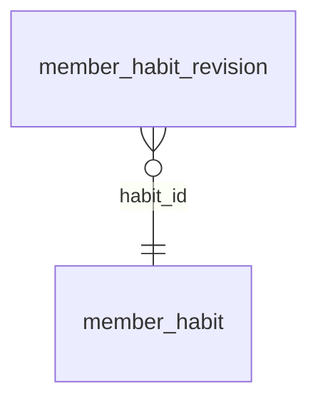

<!-- Generated by integration/db-schema-reference.ts - do not edit. Run: bun run db:docs -->

# `member_habit_revision`

Source: [src/lib/member-habit-store.ts](../../../src/lib/member-habit-store.ts)

## Columns

| Column        | Kind                    | Database type | Nullable | Default | References                             |
| ------------- | ----------------------- | ------------- | -------- | ------- | -------------------------------------- |
| `habit_id`    | UUID (primary key)      | `uuid`        | No       | –       | [`member_habit`.`id`](member_habit.md) |
| `period`      | Free text (primary key) | `text`        | No       | –       | –                                      |
| `name`        | Free text               | `text`        | No       | –       | –                                      |
| `description` | Free text               | `text`        | No       | –       | –                                      |

## Indexes

| Columns              | Unique | Where | Definition                                                                                                      |
| -------------------- | ------ | ----- | --------------------------------------------------------------------------------------------------------------- |
| `habit_id`, `period` | Yes    | –     | `CREATE UNIQUE INDEX member_habit_revision_pkey ON public.member_habit_revision USING btree (habit_id, period)` |

## Referenced by

None.

## Relations

