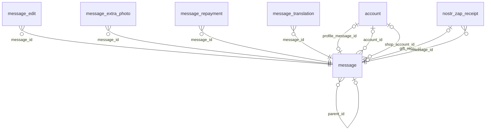

<!-- Generated by integration/db-schema-reference.ts - do not edit. Run: bun run db:docs -->

# `message`

Source: [src/lib/message-store.ts](../../../src/lib/message-store.ts)

## Columns

| Column                   | Kind               | Database type              | Nullable | Default   | References                   |
| ------------------------ | ------------------ | -------------------------- | -------- | --------- | ---------------------------- |
| `id`                     | UUID (primary key) | `uuid`                     | No       | –         | –                            |
| `account_id`             | UUID (foreign key) | `uuid`                     | Yes      | –         | [`account`.`id`](account.md) |
| `name`                   | Free text          | `text`                     | No       | –         | –                            |
| `text`                   | Free text          | `text`                     | No       | –         | –                            |
| `photo`                  | Binary             | `bytea`                    | Yes      | –         | –                            |
| `photo_content_type`     | Free text          | `text`                     | Yes      | –         | –                            |
| `photo_taken_at`         | Free text          | `text`                     | Yes      | –         | –                            |
| `created_at`             | Date/time          | `timestamp with time zone` | No       | –         | –                            |
| `event_id`               | Free text          | `text`                     | Yes      | –         | –                            |
| `nostr_publish_state`    | Free text          | `text`                     | No       | `pending` | –                            |
| `sats`                   | Integer            | `bigint`                   | No       | `0`       | –                            |
| `fiat_usd`               | Decimal            | `numeric(20,2)`            | Yes      | –         | –                            |
| `fiat_chf`               | Decimal            | `numeric(20,2)`            | Yes      | –         | –                            |
| `fiat_eur`               | Decimal            | `numeric(20,2)`            | Yes      | –         | –                            |
| `fiat_php`               | Decimal            | `numeric(20,2)`            | Yes      | –         | –                            |
| `nostr_event`            | JSON               | `jsonb`                    | Yes      | –         | –                            |
| `claimed_until`          | Date/time          | `timestamp with time zone` | Yes      | –         | –                            |
| `nostr_first_attempt_at` | Date/time          | `timestamp with time zone` | Yes      | –         | –                            |
| `nostr_publish_epoch`    | Free text          | `text`                     | Yes      | –         | –                            |
| `nostr_attempts`         | Integer            | `integer`                  | No       | `0`       | –                            |
| `video_content_type`     | Free text          | `text`                     | Yes      | –         | –                            |
| `parent_id`              | UUID (foreign key) | `uuid`                     | Yes      | –         | [`message`.`id`](message.md) |
| `author_pubkey`          | Free text          | `text`                     | Yes      | –         | –                            |
| `deleted_at`             | Date/time          | `timestamp with time zone` | Yes      | –         | –                            |
| `deleted_by`             | UUID               | `uuid`                     | Yes      | –         | –                            |
| `content_fp`             | Free text          | `text`                     | Yes      | –         | –                            |
| `goal_sats`              | Integer            | `bigint`                   | Yes      | –         | –                            |
| `video_taken_at`         | Free text          | `text`                     | Yes      | –         | –                            |
| `place_lat`              | Decimal            | `double precision`         | Yes      | –         | –                            |
| `place_lng`              | Decimal            | `double precision`         | Yes      | –         | –                            |
| `place_label`            | Free text          | `text`                     | Yes      | –         | –                            |
| `shop_account_id`        | UUID (foreign key) | `uuid`                     | Yes      | –         | [`account`.`id`](account.md) |
| `mentions`               | JSON               | `jsonb`                    | No       | `[]`      | –                            |
| `goal_currency`          | ENUM               | `text`                     | Yes      | –         | –                            |
| `goal_amount`            | Decimal            | `numeric(20,8)`            | Yes      | –         | –                            |
| `goal_fiat_usd`          | Decimal            | `numeric(20,2)`            | Yes      | –         | –                            |
| `goal_fiat_chf`          | Decimal            | `numeric(20,2)`            | Yes      | –         | –                            |
| `goal_fiat_eur`          | Decimal            | `numeric(20,2)`            | Yes      | –         | –                            |
| `goal_fiat_php`          | Decimal            | `numeric(20,2)`            | Yes      | –         | –                            |
| `goal_repayable`         | Boolean            | `boolean`                  | Yes      | –         | –                            |
| `goal_term_days`         | Integer            | `integer`                  | Yes      | –         | –                            |
| `goal_funded_at`         | Date/time          | `timestamp with time zone` | Yes      | –         | –                            |
| `received_sats`          | Integer            | `bigint`                   | No       | `0`       | –                            |
| `received_fiat_usd`      | Decimal            | `numeric(20,2)`            | Yes      | –         | –                            |
| `received_fiat_chf`      | Decimal            | `numeric(20,2)`            | Yes      | –         | –                            |
| `received_fiat_eur`      | Decimal            | `numeric(20,2)`            | Yes      | –         | –                            |
| `received_fiat_php`      | Decimal            | `numeric(20,2)`            | Yes      | –         | –                            |
| `first_post_free`        | Boolean            | `boolean`                  | Yes      | –         | –                            |

## Indexes

| Columns                                 | Unique | Where                                                                                                          | Definition                                                                                                                                                                                                                                    |
| --------------------------------------- | ------ | -------------------------------------------------------------------------------------------------------------- | --------------------------------------------------------------------------------------------------------------------------------------------------------------------------------------------------------------------------------------------- |
| `(expression)`, `created_at`, `id`      | No     | `((account_id IS NULL) AND (deleted_at IS NULL) AND (author_pubkey IS NOT NULL))`                              | `CREATE INDEX message_external_author_idx ON public.message USING btree (lower(author_pubkey), created_at DESC, id DESC) WHERE ((account_id IS NULL) AND (deleted_at IS NULL) AND (author_pubkey IS NOT NULL))`                               |
| `account_id`                            | Yes    | `(first_post_free IS TRUE)`                                                                                    | `CREATE UNIQUE INDEX message_first_post_free_uidx ON public.message USING btree (account_id) WHERE (first_post_free IS TRUE)`                                                                                                                 |
| `account_id`, `content_fp`              | Yes    | `((deleted_at IS NULL) AND (parent_id IS NULL) AND (account_id IS NOT NULL) AND (content_fp IS NOT NULL))`     | `CREATE UNIQUE INDEX message_live_top_content_fp_uidx ON public.message USING btree (account_id, content_fp) WHERE ((deleted_at IS NULL) AND (parent_id IS NULL) AND (account_id IS NOT NULL) AND (content_fp IS NOT NULL))`                  |
| `account_id`, `parent_id`, `content_fp` | Yes    | `((deleted_at IS NULL) AND (parent_id IS NOT NULL) AND (account_id IS NOT NULL) AND (content_fp IS NOT NULL))` | `CREATE UNIQUE INDEX message_live_reply_content_fp_uidx ON public.message USING btree (account_id, parent_id, content_fp) WHERE ((deleted_at IS NULL) AND (parent_id IS NOT NULL) AND (account_id IS NOT NULL) AND (content_fp IS NOT NULL))` |
| `created_at`, `id`                      | No     | –                                                                                                              | `CREATE INDEX message_created_at_idx ON public.message USING btree (created_at DESC, id DESC)`                                                                                                                                                |
| `created_at`, `id`                      | No     | `((parent_id IS NULL) AND (deleted_at IS NULL))`                                                               | `CREATE INDEX message_feed_created_idx ON public.message USING btree (created_at DESC, id DESC) WHERE ((parent_id IS NULL) AND (deleted_at IS NULL))`                                                                                         |
| `event_id`                              | Yes    | `(event_id IS NOT NULL)`                                                                                       | `CREATE UNIQUE INDEX message_event_id_uidx ON public.message USING btree (event_id) WHERE (event_id IS NOT NULL)`                                                                                                                             |
| `id`                                    | No     | `((nostr_event IS NOT NULL) AND (jsonb_typeof(nostr_event) = 'string'::text))`                                 | `CREATE INDEX message_nostr_event_unrepaired_idx ON public.message USING btree (id) WHERE ((nostr_event IS NOT NULL) AND (jsonb_typeof(nostr_event) = 'string'::text))`                                                                       |
| `id`                                    | Yes    | –                                                                                                              | `CREATE UNIQUE INDEX message_pkey ON public.message USING btree (id)`                                                                                                                                                                         |
| `parent_id`, `created_at`, `id`         | No     | –                                                                                                              | `CREATE INDEX message_parent_id_idx ON public.message USING btree (parent_id, created_at, id)`                                                                                                                                                |
| `sats`, `created_at`, `id`              | No     | `((parent_id IS NULL) AND (deleted_at IS NULL) AND (sats > 0))`                                                | `CREATE INDEX message_feed_popular_idx ON public.message USING btree (sats DESC, created_at DESC, id DESC) WHERE ((parent_id IS NULL) AND (deleted_at IS NULL) AND (sats > 0))`                                                               |

## Referenced by

| Table                 | Column               | Points to |
| --------------------- | -------------------- | --------- |
| `account`             | `profile_message_id` | `id`      |
| `message`             | `parent_id`          | `id`      |
| `message_edit`        | `message_id`         | `id`      |
| `message_extra_photo` | `message_id`         | `id`      |
| `message_repayment`   | `message_id`         | `id`      |
| `message_translation` | `message_id`         | `id`      |
| `nostr_zap_receipt`   | `gift_reply_id`      | `id`      |
| `nostr_zap_receipt`   | `message_id`         | `id`      |

## Relations

