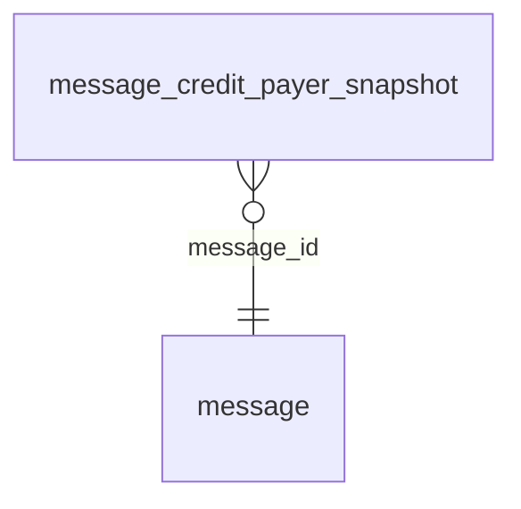

<!-- Generated by integration/db-schema-reference.ts - do not edit. Run: bun run db:docs -->

# `message_credit_payer_snapshot`

Source: [src/lib/message-store.ts](../../../src/lib/message-store.ts)

## Columns

| Column       | Kind               | Database type | Nullable | Default | References                   |
| ------------ | ------------------ | ------------- | -------- | ------- | ---------------------------- |
| `message_id` | UUID (primary key) | `uuid`        | No       | –       | [`message`.`id`](message.md) |
| `account_id` | UUID (primary key) | `uuid`        | No       | –       | –                            |
| `currency`   | ENUM               | `text`        | No       | –       | –                            |
| `units`      | Integer            | `bigint`      | No       | –       | –                            |

## Indexes

| Columns                    | Unique | Where | Definition                                                                                                                            |
| -------------------------- | ------ | ----- | ------------------------------------------------------------------------------------------------------------------------------------- |
| `message_id`, `account_id` | Yes    | –     | `CREATE UNIQUE INDEX message_credit_payer_snapshot_pkey ON public.message_credit_payer_snapshot USING btree (message_id, account_id)` |

## Referenced by

None.

## Relations

