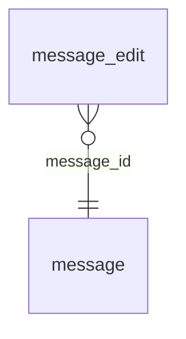

<!-- Generated by integration/db-schema-reference.ts - do not edit. Run: bun run db:docs -->

# `message_edit`

Source: [src/lib/message-store.ts](../../../src/lib/message-store.ts)

## Columns

| Column       | Kind               | Database type              | Nullable | Default | References                   |
| ------------ | ------------------ | -------------------------- | -------- | ------- | ---------------------------- |
| `id`         | UUID (primary key) | `uuid`                     | No       | –       | –                            |
| `message_id` | UUID (foreign key) | `uuid`                     | No       | –       | [`message`.`id`](message.md) |
| `actor_id`   | UUID               | `uuid`                     | No       | –       | –                            |
| `created_at` | Date/time          | `timestamp with time zone` | No       | –       | –                            |
| `field`      | ENUM               | `text`                     | No       | –       | –                            |
| `before`     | JSON               | `jsonb`                    | No       | –       | –                            |
| `after`      | JSON               | `jsonb`                    | No       | –       | –                            |

## Indexes

| Columns                          | Unique | Where |
| -------------------------------- | ------ | ----- |
| `id`                             | Yes    | –     |
| `message_id`, `created_at`, `id` | No     | –     |

## Referenced by

None.

## Relations

