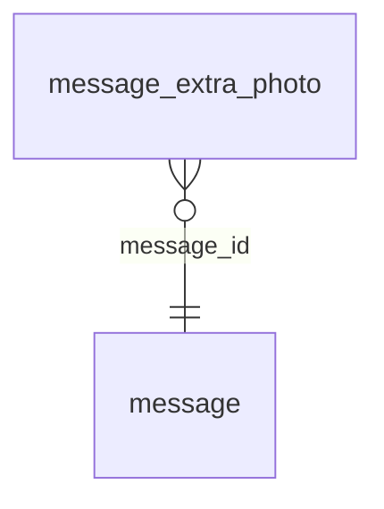

<!-- Generated by integration/db-schema-reference.ts - do not edit. Run: bun run db:docs -->

# `message_extra_photo`

Source: [src/lib/message-store.ts](../../../src/lib/message-store.ts)

## Columns

| Column               | Kind                  | Database type | Nullable | Default | References                   |
| -------------------- | --------------------- | ------------- | -------- | ------- | ---------------------------- |
| `message_id`         | UUID (primary key)    | `uuid`        | No       | –       | [`message`.`id`](message.md) |
| `idx`                | Integer (primary key) | `smallint`    | No       | –       | –                            |
| `photo`              | Binary                | `bytea`       | No       | –       | –                            |
| `photo_content_type` | Free text             | `text`        | No       | –       | –                            |
| `photo_taken_at`     | Free text             | `text`        | Yes      | –       | –                            |

## Indexes

| Columns             | Unique | Where |
| ------------------- | ------ | ----- |
| `message_id`, `idx` | Yes    | –     |

## Referenced by

None.

## Relations

