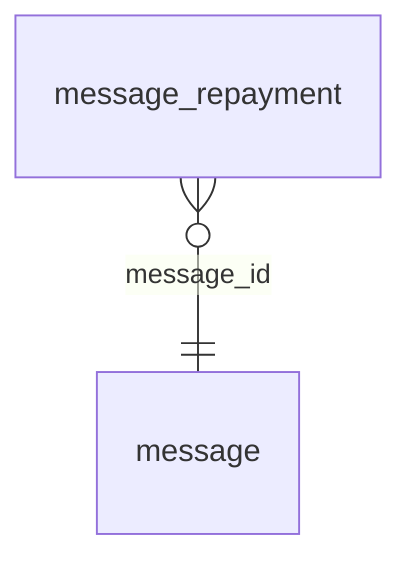

<!-- Generated by integration/db-schema-reference.ts - do not edit. Run: bun run db:docs -->

# `message_repayment`

Source: [src/lib/message-store.ts](../../../src/lib/message-store.ts)

## Columns

| Column                 | Kind                  | Database type              | Nullable | Default | References                   |
| ---------------------- | --------------------- | -------------------------- | -------- | ------- | ---------------------------- |
| `message_id`           | UUID (primary key)    | `uuid`                     | No       | –       | [`message`.`id`](message.md) |
| `day_index`            | Integer (primary key) | `integer`                  | No       | –       | –                            |
| `recipient_account_id` | UUID (primary key)    | `uuid`                     | No       | –       | –                            |
| `due_sats`             | Integer               | `bigint`                   | No       | –       | –                            |
| `paid_at`              | Date/time             | `timestamp with time zone` | No       | –       | –                            |

## Indexes

| Columns                                           | Unique | Where |
| ------------------------------------------------- | ------ | ----- |
| `message_id`, `day_index`, `recipient_account_id` | Yes    | –     |

## Referenced by

None.

## Relations

