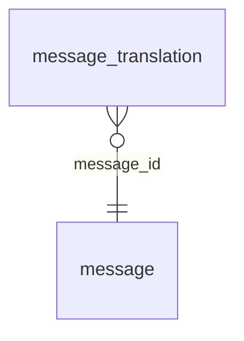

<!-- Generated by integration/db-schema-reference.ts - do not edit. Run: bun run db:docs -->

# `message_translation`

Source: [src/lib/translation-store.ts](../../../src/lib/translation-store.ts)

## Columns

| Column            | Kind                    | Database type              | Nullable | Default | References                   |
| ----------------- | ----------------------- | -------------------------- | -------- | ------- | ---------------------------- |
| `message_id`      | UUID (primary key)      | `uuid`                     | No       | –       | [`message`.`id`](message.md) |
| `target_lang`     | Free text (primary key) | `text`                     | No       | –       | –                            |
| `source_sha256`   | Free text               | `text`                     | No       | –       | –                            |
| `translated_text` | Free text               | `text`                     | No       | –       | –                            |
| `created_at`      | Date/time               | `timestamp with time zone` | No       | –       | –                            |

## Indexes

| Columns                     | Unique | Where | Definition                                                                                                         |
| --------------------------- | ------ | ----- | ------------------------------------------------------------------------------------------------------------------ |
| `message_id`, `target_lang` | Yes    | –     | `CREATE UNIQUE INDEX message_translation_pkey ON public.message_translation USING btree (message_id, target_lang)` |

## Referenced by

None.

## Relations

