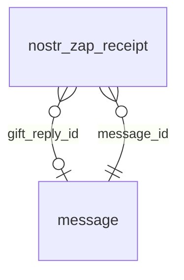

<!-- Generated by integration/db-schema-reference.ts - do not edit. Run: bun run db:docs -->

# `nostr_zap_receipt`

Source: [src/lib/message-store.ts](../../../src/lib/message-store.ts)

## Columns

| Column             | Kind                    | Database type              | Nullable | Default | References                   |
| ------------------ | ----------------------- | -------------------------- | -------- | ------- | ---------------------------- |
| `event_id`         | Free text (primary key) | `text`                     | No       | –       | –                            |
| `message_id`       | UUID (foreign key)      | `uuid`                     | No       | –       | [`message`.`id`](message.md) |
| `sats`             | Integer                 | `bigint`                   | No       | –       | –                            |
| `payer_account_id` | UUID                    | `uuid`                     | Yes      | –       | –                            |
| `payer_pubkey`     | Free text               | `text`                     | Yes      | –       | –                            |
| `zap_request_id`   | Free text               | `text`                     | Yes      | –       | –                            |
| `gift_reply_id`    | UUID (foreign key)      | `uuid`                     | Yes      | –       | [`message`.`id`](message.md) |
| `comment`          | Free text               | `text`                     | No       | ``      | –                            |
| `recorded_at`      | Date/time               | `timestamp with time zone` | Yes      | –       | –                            |

## Indexes

| Columns          | Unique | Where                          |
| ---------------- | ------ | ------------------------------ |
| `event_id`       | Yes    | –                              |
| `gift_reply_id`  | Yes    | `(gift_reply_id IS NOT NULL)`  |
| `zap_request_id` | Yes    | `(zap_request_id IS NOT NULL)` |

## Referenced by

None.

## Relations

