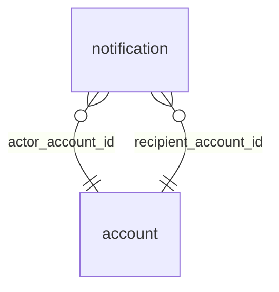

<!-- Generated by integration/db-schema-reference.ts - do not edit. Run: bun run db:docs -->

# `notification`

Source: [src/lib/notification-store.ts](../../../src/lib/notification-store.ts)

## Columns

| Column                 | Kind               | Database type              | Nullable | Default | References                   |
| ---------------------- | ------------------ | -------------------------- | -------- | ------- | ---------------------------- |
| `id`                   | UUID (primary key) | `uuid`                     | No       | –       | –                            |
| `recipient_account_id` | UUID (foreign key) | `uuid`                     | No       | –       | [`account`.`id`](account.md) |
| `actor_account_id`     | UUID (foreign key) | `uuid`                     | No       | –       | [`account`.`id`](account.md) |
| `type`                 | Free text          | `text`                     | No       | –       | –                            |
| `parent_id`            | UUID               | `uuid`                     | No       | –       | –                            |
| `reply_id`             | UUID               | `uuid`                     | No       | –       | –                            |
| `name`                 | Free text          | `text`                     | No       | –       | –                            |
| `text`                 | Free text          | `text`                     | No       | –       | –                            |
| `created_at`           | Date/time          | `timestamp with time zone` | No       | –       | –                            |
| `read_at`              | Date/time          | `timestamp with time zone` | Yes      | –       | –                            |

## Indexes

| Columns                                    | Unique | Where |
| ------------------------------------------ | ------ | ----- |
| `id`                                       | Yes    | –     |
| `recipient_account_id`, `created_at`, `id` | No     | –     |
| `recipient_account_id`, `type`, `reply_id` | Yes    | –     |

## Referenced by

None.

## Relations

