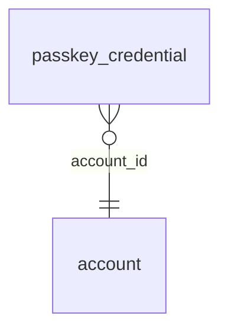

<!-- Generated by integration/db-schema-reference.ts - do not edit. Run: bun run db:docs -->

# `passkey_credential`

Source: [src/lib/auth/schema.ts](../../../src/lib/auth/schema.ts)

## Columns

| Column          | Kind                    | Database type              | Nullable | Default | References                   |
| --------------- | ----------------------- | -------------------------- | -------- | ------- | ---------------------------- |
| `credential_id` | Free text (primary key) | `text`                     | No       | –       | –                            |
| `public_key`    | Binary                  | `bytea`                    | No       | –       | –                            |
| `sign_count`    | Integer                 | `integer`                  | No       | –       | –                            |
| `account_id`    | UUID (foreign key)      | `uuid`                     | No       | –       | [`account`.`id`](account.md) |
| `created_at`    | Date/time               | `timestamp with time zone` | No       | –       | –                            |

## Indexes

| Columns         | Unique | Where |
| --------------- | ------ | ----- |
| `credential_id` | Yes    | –     |

## Referenced by

None.

## Relations

