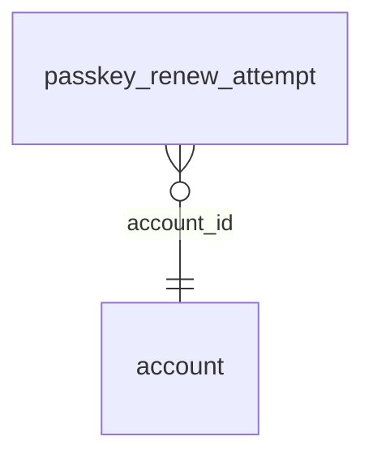

<!-- Generated by integration/db-schema-reference.ts - do not edit. Run: bun run db:docs -->

# `passkey_renew_attempt`

Source: [src/lib/auth/schema.ts](../../../src/lib/auth/schema.ts)

## Columns

| Column                     | Kind               | Database type              | Nullable | Default | References                   |
| -------------------------- | ------------------ | -------------------------- | -------- | ------- | ---------------------------- |
| `id`                       | UUID (primary key) | `uuid`                     | No       | –       | –                            |
| `account_id`               | UUID (foreign key) | `uuid`                     | No       | –       | [`account`.`id`](account.md) |
| `created_at`               | Date/time          | `timestamp with time zone` | No       | –       | –                            |
| `stage`                    | ENUM               | `text`                     | No       | –       | –                            |
| `outcome`                  | ENUM               | `text`                     | No       | –       | –                            |
| `error_name`               | Free text          | `text`                     | Yes      | –       | –                            |
| `error_code`               | Free text          | `text`                     | Yes      | –       | –                            |
| `http_status`              | Integer            | `integer`                  | Yes      | –       | –                            |
| `message`                  | Free text          | `text`                     | Yes      | –       | –                            |
| `user_agent`               | Free text          | `text`                     | Yes      | –       | –                            |
| `acknowledged_at`          | Date/time          | `timestamp with time zone` | Yes      | –       | –                            |
| `authenticator_attachment` | ENUM               | `text`                     | Yes      | –       | –                            |
| `transports`               | Free text          | `text`                     | Yes      | –       | –                            |
| `aaguid`                   | Free text          | `text`                     | Yes      | –       | –                            |
| `prf_enabled`              | Boolean            | `boolean`                  | Yes      | –       | –                            |
| `prf_present`              | Boolean            | `boolean`                  | Yes      | –       | –                            |
| `extensions`               | Free text          | `text`                     | Yes      | –       | –                            |
| `authenticator_flags`      | Integer            | `integer`                  | Yes      | –       | –                            |
| `public_key_algorithm`     | Integer            | `integer`                  | Yes      | –       | –                            |
| `resident_key`             | Boolean            | `boolean`                  | Yes      | –       | –                            |
| `hmac_secret`              | Boolean            | `boolean`                  | Yes      | –       | –                            |
| `cred_protect`             | ENUM               | `text`                     | Yes      | –       | –                            |
| `client_capabilities`      | Free text          | `text`                     | Yes      | –       | –                            |

## Indexes

| Columns                    | Unique | Where |
| -------------------------- | ------ | ----- |
| `account_id`, `created_at` | No     | –     |
| `id`                       | Yes    | –     |

## Referenced by

None.

## Relations

