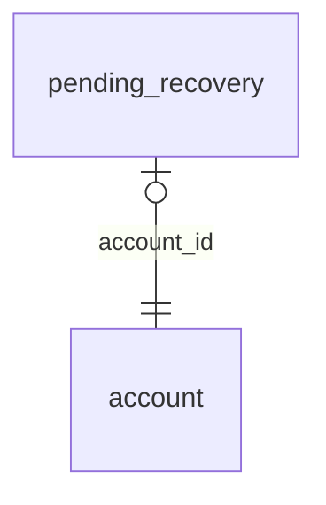

<!-- Generated by integration/db-schema-reference.ts - do not edit. Run: bun run db:docs -->

# `pending_recovery`

Source: [src/lib/auth/schema.ts](../../../src/lib/auth/schema.ts)

## Columns

| Column             | Kind               | Database type              | Nullable | Default | References                   |
| ------------------ | ------------------ | -------------------------- | -------- | ------- | ---------------------------- |
| `account_id`       | UUID (primary key) | `uuid`                     | No       | –       | [`account`.`id`](account.md) |
| `old_spark_pubkey` | Free text          | `text`                     | No       | –       | –                            |
| `new_spark_pubkey` | Free text          | `text`                     | No       | –       | –                            |
| `credential_id`    | Free text          | `text`                     | No       | –       | –                            |
| `public_key`       | Binary             | `bytea`                    | No       | –       | –                            |
| `sign_count`       | Integer            | `integer`                  | No       | –       | –                            |
| `created_at`       | Date/time          | `timestamp with time zone` | No       | –       | –                            |
| `forwarded_at`     | Date/time          | `timestamp with time zone` | Yes      | –       | –                            |

## Indexes

| Columns            | Unique | Where | Definition                                                                                                             |
| ------------------ | ------ | ----- | ---------------------------------------------------------------------------------------------------------------------- |
| `account_id`       | Yes    | –     | `CREATE UNIQUE INDEX pending_recovery_pkey ON public.pending_recovery USING btree (account_id)`                        |
| `credential_id`    | Yes    | –     | `CREATE UNIQUE INDEX pending_recovery_credential_id_uidx ON public.pending_recovery USING btree (credential_id)`       |
| `new_spark_pubkey` | Yes    | –     | `CREATE UNIQUE INDEX pending_recovery_new_spark_pubkey_uidx ON public.pending_recovery USING btree (new_spark_pubkey)` |

## Referenced by

None.

## Relations

