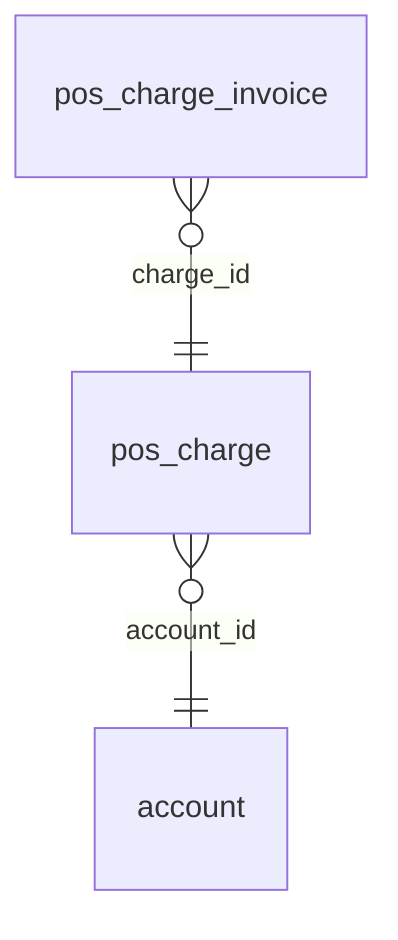

<!-- Generated by integration/db-schema-reference.ts - do not edit. Run: bun run db:docs -->

# `pos_charge`

Source: [src/lib/pos-store.ts](../../../src/lib/pos-store.ts)

## Columns

| Column          | Kind               | Database type              | Nullable | Default | References                   |
| --------------- | ------------------ | -------------------------- | -------- | ------- | ---------------------------- |
| `id`            | UUID (primary key) | `uuid`                     | No       | –       | –                            |
| `account_id`    | UUID (foreign key) | `uuid`                     | No       | –       | [`account`.`id`](account.md) |
| `amount_sats`   | Integer            | `bigint`                   | No       | –       | –                            |
| `status`        | ENUM               | `text`                     | No       | –       | –                            |
| `created_at`    | Date/time          | `timestamp with time zone` | No       | –       | –                            |
| `expires_at`    | Date/time          | `timestamp with time zone` | No       | –       | –                            |
| `paid_at`       | Date/time          | `timestamp with time zone` | Yes      | –       | –                            |
| `spark_invoice` | Free text          | `text`                     | Yes      | –       | –                            |

## Indexes

| Columns                          | Unique | Where                                                      | Definition                                                                                                                                       |
| -------------------------------- | ------ | ---------------------------------------------------------- | ------------------------------------------------------------------------------------------------------------------------------------------------ |
| `account_id`                     | Yes    | `(status = 'pending'::text)`                               | `CREATE UNIQUE INDEX pos_charge_account_pending_idx ON public.pos_charge USING btree (account_id) WHERE (status = 'pending'::text)`              |
| `account_id`, `created_at`, `id` | No     | –                                                          | `CREATE INDEX pos_charge_account_created_idx ON public.pos_charge USING btree (account_id, created_at DESC, id DESC)`                            |
| `expires_at`                     | No     | `(status = ANY (ARRAY['pending'::text, 'expired'::text]))` | `CREATE INDEX pos_charge_watch_idx ON public.pos_charge USING btree (expires_at) WHERE (status = ANY (ARRAY['pending'::text, 'expired'::text]))` |
| `id`                             | Yes    | –                                                          | `CREATE UNIQUE INDEX pos_charge_pkey ON public.pos_charge USING btree (id)`                                                                      |

## Referenced by

| Table                | Column      | Points to |
| -------------------- | ----------- | --------- |
| `pos_charge_invoice` | `charge_id` | `id`      |

## Relations

