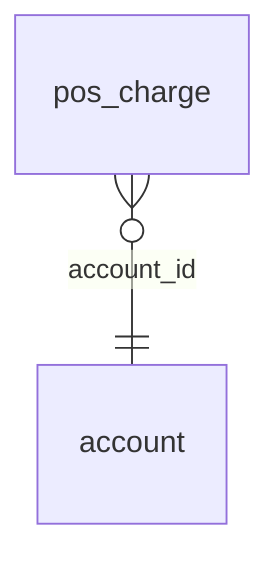

<!-- Generated by integration/db-schema-reference.ts - do not edit. Run: bun run db:docs -->

# `pos_charge`

Source: [src/lib/pos-store.ts](../../../src/lib/pos-store.ts)

## Columns

| Column        | Kind               | Database type              | Nullable | Default | References                   |
| ------------- | ------------------ | -------------------------- | -------- | ------- | ---------------------------- |
| `id`          | UUID (primary key) | `uuid`                     | No       | –       | –                            |
| `account_id`  | UUID (foreign key) | `uuid`                     | No       | –       | [`account`.`id`](account.md) |
| `amount_sats` | Integer            | `bigint`                   | No       | –       | –                            |
| `status`      | ENUM               | `text`                     | No       | –       | –                            |
| `created_at`  | Date/time          | `timestamp with time zone` | No       | –       | –                            |
| `expires_at`  | Date/time          | `timestamp with time zone` | No       | –       | –                            |

## Indexes

| Columns                          | Unique | Where                        |
| -------------------------------- | ------ | ---------------------------- |
| `account_id`                     | Yes    | `(status = 'pending'::text)` |
| `account_id`, `created_at`, `id` | No     | –                            |
| `id`                             | Yes    | –                            |

## Referenced by

None.

## Relations

