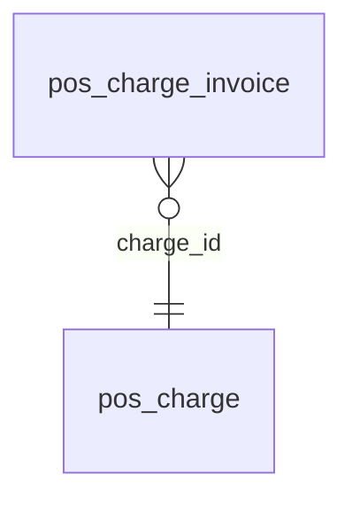

<!-- Generated by integration/db-schema-reference.ts - do not edit. Run: bun run db:docs -->

# `pos_charge_invoice`

Source: [src/lib/pos-store.ts](../../../src/lib/pos-store.ts)

## Columns

| Column         | Kind                    | Database type              | Nullable | Default | References                         |
| -------------- | ----------------------- | -------------------------- | -------- | ------- | ---------------------------------- |
| `payment_hash` | Free text (primary key) | `text`                     | No       | –       | –                                  |
| `charge_id`    | UUID (foreign key)      | `uuid`                     | No       | –       | [`pos_charge`.`id`](pos_charge.md) |
| `created_at`   | Date/time               | `timestamp with time zone` | No       | –       | –                                  |

## Indexes

| Columns                   | Unique | Where | Definition                                                                                                    |
| ------------------------- | ------ | ----- | ------------------------------------------------------------------------------------------------------------- |
| `charge_id`, `created_at` | No     | –     | `CREATE INDEX pos_charge_invoice_charge_idx ON public.pos_charge_invoice USING btree (charge_id, created_at)` |
| `payment_hash`            | Yes    | –     | `CREATE UNIQUE INDEX pos_charge_invoice_pkey ON public.pos_charge_invoice USING btree (payment_hash)`         |

## Referenced by

None.

## Relations

