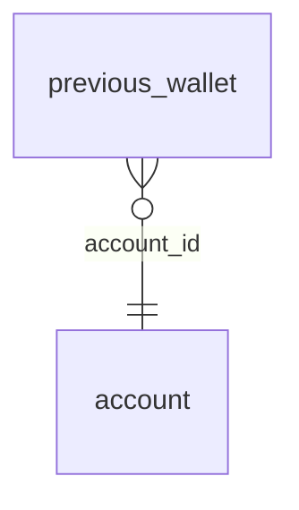

<!-- Generated by integration/db-schema-reference.ts - do not edit. Run: bun run db:docs -->

# `previous_wallet`

Source: [src/lib/auth/schema.ts](../../../src/lib/auth/schema.ts)

## Columns

| Column          | Kind                    | Database type              | Nullable | Default | References                   |
| --------------- | ----------------------- | -------------------------- | -------- | ------- | ---------------------------- |
| `account_id`    | UUID (primary key)      | `uuid`                     | No       | –       | [`account`.`id`](account.md) |
| `spark_pubkey`  | Free text (primary key) | `text`                     | No       | –       | –                            |
| `spark_address` | Free text               | `text`                     | No       | –       | –                            |
| `replaced_at`   | Date/time               | `timestamp with time zone` | No       | –       | –                            |

## Indexes

| Columns                      | Unique | Where | Definition                                                                                                  |
| ---------------------------- | ------ | ----- | ----------------------------------------------------------------------------------------------------------- |
| `account_id`, `spark_pubkey` | Yes    | –     | `CREATE UNIQUE INDEX previous_wallet_pkey ON public.previous_wallet USING btree (account_id, spark_pubkey)` |
| `spark_pubkey`               | No     | –     | `CREATE INDEX previous_wallet_spark_pubkey_idx ON public.previous_wallet USING btree (spark_pubkey)`        |

## Referenced by

None.

## Relations

