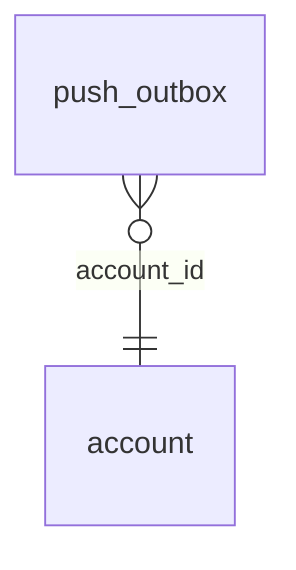

<!-- Generated by integration/db-schema-reference.ts - do not edit. Run: bun run db:docs -->

# `push_outbox`

Source: [src/lib/push-store.ts](../../../src/lib/push-store.ts)

## Columns

| Column                | Kind               | Database type              | Nullable | Default   | References                   |
| --------------------- | ------------------ | -------------------------- | -------- | --------- | ---------------------------- |
| `id`                  | UUID (primary key) | `uuid`                     | No       | –         | –                            |
| `account_id`          | UUID (foreign key) | `uuid`                     | No       | –         | [`account`.`id`](account.md) |
| `type`                | ENUM               | `text`                     | No       | –         | –                            |
| `message_id`          | UUID               | `uuid`                     | Yes      | –         | –                            |
| `payload`             | Free text          | `text`                     | No       | –         | –                            |
| `status`              | ENUM               | `text`                     | No       | `pending` | –                            |
| `attempts`            | Integer            | `integer`                  | No       | `0`       | –                            |
| `claimed_until`       | Date/time          | `timestamp with time zone` | Yes      | –         | –                            |
| `created_at`          | Date/time          | `timestamp with time zone` | No       | –         | –                            |
| `delivered_endpoints` | Free text          | `text`                     | No       | `[]`      | –                            |
| `skip_endpoints`      | Free text          | `text`                     | No       | `[]`      | –                            |

## Indexes

| Columns            | Unique | Where                        | Definition                                                                                                                 |
| ------------------ | ------ | ---------------------------- | -------------------------------------------------------------------------------------------------------------------------- |
| `created_at`, `id` | No     | `(status = 'pending'::text)` | `CREATE INDEX push_outbox_pending_idx ON public.push_outbox USING btree (created_at, id) WHERE (status = 'pending'::text)` |
| `id`               | Yes    | –                            | `CREATE UNIQUE INDEX push_outbox_pkey ON public.push_outbox USING btree (id)`                                              |

## Referenced by

None.

## Relations

