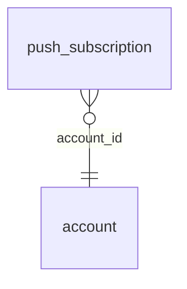

<!-- Generated by integration/db-schema-reference.ts - do not edit. Run: bun run db:docs -->

# `push_subscription`

Source: [src/lib/push-store.ts](../../../src/lib/push-store.ts)

## Columns

| Column       | Kind                    | Database type              | Nullable | Default | References                   |
| ------------ | ----------------------- | -------------------------- | -------- | ------- | ---------------------------- |
| `endpoint`   | Free text (primary key) | `text`                     | No       | –       | –                            |
| `account_id` | UUID (foreign key)      | `uuid`                     | No       | –       | [`account`.`id`](account.md) |
| `p256dh`     | Free text               | `text`                     | No       | –       | –                            |
| `auth`       | Free text               | `text`                     | No       | –       | –                            |
| `created_at` | Date/time               | `timestamp with time zone` | No       | –       | –                            |

## Indexes

| Columns      | Unique | Where | Definition                                                                                           |
| ------------ | ------ | ----- | ---------------------------------------------------------------------------------------------------- |
| `account_id` | No     | –     | `CREATE INDEX push_subscription_account_id_idx ON public.push_subscription USING btree (account_id)` |
| `endpoint`   | Yes    | –     | `CREATE UNIQUE INDEX push_subscription_pkey ON public.push_subscription USING btree (endpoint)`      |

## Referenced by

None.

## Relations

