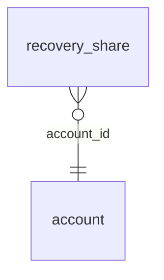

<!-- Generated by integration/db-schema-reference.ts - do not edit. Run: bun run db:docs -->

# `recovery_share`

Source: [src/lib/auth/schema.ts](../../../src/lib/auth/schema.ts)

## Columns

| Column                      | Kind                    | Database type              | Nullable | Default | References                   |
| --------------------------- | ----------------------- | -------------------------- | -------- | ------- | ---------------------------- |
| `account_id`                | UUID (primary key)      | `uuid`                     | No       | –       | [`account`.`id`](account.md) |
| `spark_pubkey`              | Free text (primary key) | `text`                     | No       | –       | –                            |
| `recovery_share_ciphertext` | Binary                  | `bytea`                    | No       | –       | –                            |
| `stored_at`                 | Date/time               | `timestamp with time zone` | No       | –       | –                            |

## Indexes

| Columns                      | Unique | Where | Definition                                                                                                |
| ---------------------------- | ------ | ----- | --------------------------------------------------------------------------------------------------------- |
| `account_id`, `spark_pubkey` | Yes    | –     | `CREATE UNIQUE INDEX recovery_share_pkey ON public.recovery_share USING btree (account_id, spark_pubkey)` |

## Referenced by

None.

## Relations

