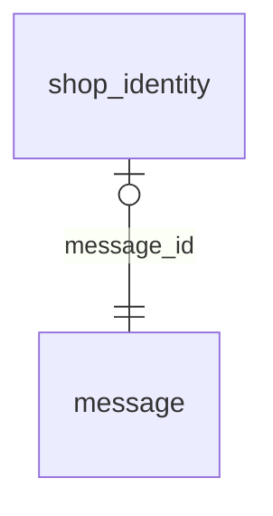

<!-- Generated by integration/db-schema-reference.ts - do not edit. Run: bun run db:docs -->

# `shop_identity`

Source: [src/lib/shop-identity.ts](../../../src/lib/shop-identity.ts)

## Columns

| Column                     | Kind               | Database type              | Nullable | Default | References                   |
| -------------------------- | ------------------ | -------------------------- | -------- | ------- | ---------------------------- |
| `message_id`               | UUID (primary key) | `uuid`                     | No       | –       | [`message`.`id`](message.md) |
| `nostr_pubkey`             | Free text          | `text`                     | No       | –       | –                            |
| `nostr_nsec_ciphertext`    | Binary             | `bytea`                    | No       | –       | –                            |
| `nostr_kek_id`             | Integer            | `integer`                  | No       | –       | –                            |
| `nostr_key_custody`        | ENUM               | `text`                     | No       | –       | –                            |
| `nostr_key_created_at`     | Date/time          | `timestamp with time zone` | No       | –       | –                            |
| `profile_name`             | Free text          | `text`                     | No       | –       | –                            |
| `ocp_photos_hash`          | Free text          | `text`                     | Yes      | –       | –                            |
| `ocp_photos_pending`       | Boolean            | `boolean`                  | No       | `false` | –                            |
| `ocp_photos_generation`    | Integer            | `integer`                  | No       | `0`     | –                            |
| `ocp_photos_claimed_until` | Date/time          | `timestamp with time zone` | Yes      | –       | –                            |
| `ocp_photos_claim`         | Integer            | `integer`                  | No       | `0`     | –                            |
| `ocp_place_pending`        | Boolean            | `boolean`                  | No       | `false` | –                            |
| `ocp_place_generation`     | Integer            | `integer`                  | No       | `0`     | –                            |
| `ocp_place_claimed_until`  | Date/time          | `timestamp with time zone` | Yes      | –       | –                            |
| `ocp_place_claim`          | Integer            | `integer`                  | No       | `0`     | –                            |
| `ocp_revision`             | Integer            | `bigint`                   | No       | `0`     | –                            |

## Indexes

| Columns                              | Unique | Where | Definition                                                                                                        |
| ------------------------------------ | ------ | ----- | ----------------------------------------------------------------------------------------------------------------- |
| `message_id`                         | Yes    | –     | `CREATE UNIQUE INDEX shop_identity_pkey ON public.shop_identity USING btree (message_id)`                         |
| `nostr_key_created_at`, `message_id` | No     | –     | `CREATE INDEX shop_identity_key_order_idx ON public.shop_identity USING btree (nostr_key_created_at, message_id)` |
| `nostr_pubkey`                       | Yes    | –     | `CREATE UNIQUE INDEX shop_identity_nostr_pubkey_key ON public.shop_identity USING btree (nostr_pubkey)`           |

## Referenced by

None.

## Relations

