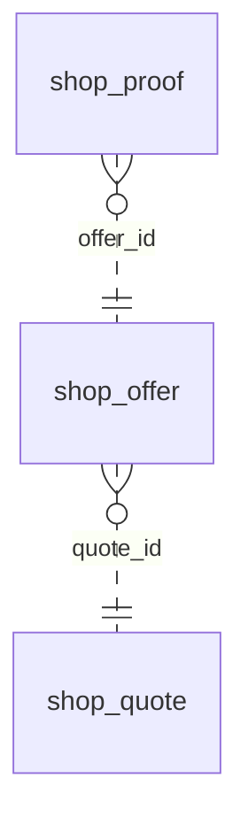

<!-- Generated by integration/db-schema-reference.ts - do not edit. Run: bun run db:docs -->

# `shop_offer`

Source: [src/lib/shop-payment-store.ts](../../../src/lib/shop-payment-store.ts)

## Columns

| Column                   | Kind               | Database type              | Nullable | Default | References                         |
| ------------------------ | ------------------ | -------------------------- | -------- | ------- | ---------------------------------- |
| `id`                     | UUID (primary key) | `uuid`                     | No       | –       | –                                  |
| `quote_id`               | UUID (foreign key) | `uuid`                     | No       | –       | [`shop_quote`.`id`](shop_quote.md) |
| `method`                 | Free text          | `text`                     | No       | –       | –                                  |
| `chain_id`               | Integer            | `integer`                  | No       | –       | –                                  |
| `asset`                  | ENUM               | `text`                     | No       | –       | –                                  |
| `token_address`          | Free text          | `text`                     | No       | –       | –                                  |
| `deposit_address`        | Free text          | `text`                     | No       | –       | –                                  |
| `amount_in`              | Decimal            | `numeric(78,0)`            | No       | –       | –                                  |
| `required_amount_in`     | Decimal            | `numeric(78,0)`            | Yes      | –       | –                                  |
| `max_accepted_amount_in` | Decimal            | `numeric(78,0)`            | Yes      | –       | –                                  |
| `decimals`               | Integer            | `smallint`                 | No       | –       | –                                  |
| `min_fee`                | Decimal            | `numeric(78,0)`            | No       | –       | –                                  |
| `provider_ref`           | Free text          | `text`                     | No       | –       | –                                  |
| `idempotency_key`        | Free text          | `text`                     | No       | –       | –                                  |
| `expires_at`             | Date/time          | `timestamp with time zone` | No       | –       | –                                  |
| `detail_issued_at`       | Date/time          | `timestamp with time zone` | Yes      | –       | –                                  |
| `created_at`             | Date/time          | `timestamp with time zone` | No       | –       | –                                  |

## Indexes

| Columns                       | Unique | Where | Definition                                                                                                            |
| ----------------------------- | ------ | ----- | --------------------------------------------------------------------------------------------------------------------- |
| `deposit_address`             | Yes    | –     | `CREATE UNIQUE INDEX shop_offer_deposit_idx ON public.shop_offer USING btree (deposit_address)`                       |
| `id`                          | Yes    | –     | `CREATE UNIQUE INDEX shop_offer_pkey ON public.shop_offer USING btree (id)`                                           |
| `quote_id`, `method`, `asset` | Yes    | –     | `CREATE UNIQUE INDEX shop_offer_quote_id_method_asset_key ON public.shop_offer USING btree (quote_id, method, asset)` |

## Referenced by

| Table        | Column     | Points to |
| ------------ | ---------- | --------- |
| `shop_proof` | `offer_id` | `id`      |

## Relations

