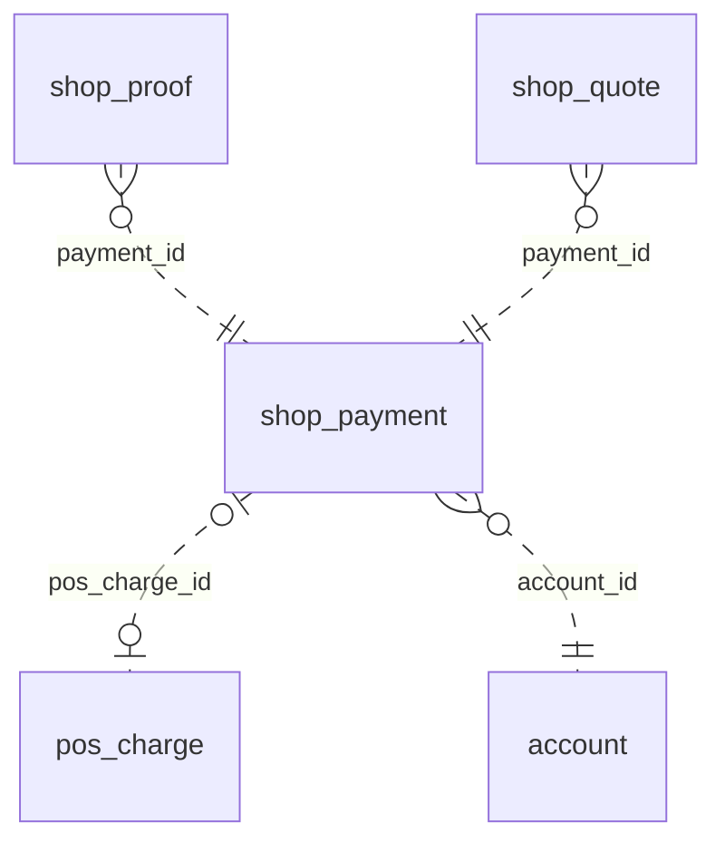

<!-- Generated by integration/db-schema-reference.ts - do not edit. Run: bun run db:docs -->

# `shop_payment`

Source: [src/lib/shop-payment-store.ts](../../../src/lib/shop-payment-store.ts)

## Columns

| Column                 | Kind               | Database type              | Nullable | Default | References                         |
| ---------------------- | ------------------ | -------------------------- | -------- | ------- | ---------------------------------- |
| `id`                   | UUID (primary key) | `uuid`                     | No       | –       | –                                  |
| `account_id`           | UUID (foreign key) | `uuid`                     | No       | –       | [`account`.`id`](account.md)       |
| `amount_sats`          | Integer            | `bigint`                   | No       | –       | –                                  |
| `pos_charge_id`        | UUID (foreign key) | `uuid`                     | Yes      | –       | [`pos_charge`.`id`](pos_charge.md) |
| `bolt11`               | Free text          | `text`                     | No       | –       | –                                  |
| `payment_hash`         | Free text          | `text`                     | No       | –       | –                                  |
| `bolt11_expires_at`    | Date/time          | `timestamp with time zone` | No       | –       | –                                  |
| `status`               | ENUM               | `text`                     | No       | –       | –                                  |
| `end_reason`           | ENUM               | `text`                     | Yes      | –       | –                                  |
| `window_ends_at`       | Date/time          | `timestamp with time zone` | No       | –       | –                                  |
| `replacements`         | Integer            | `integer`                  | No       | `0`     | –                                  |
| `next_settle_at`       | Date/time          | `timestamp with time zone` | Yes      | –       | –                                  |
| `next_history_at`      | Date/time          | `timestamp with time zone` | Yes      | –       | –                                  |
| `history_offset`       | Integer            | `integer`                  | No       | `0`     | –                                  |
| `successor_wait_until` | Date/time          | `timestamp with time zone` | Yes      | –       | –                                  |
| `created_at`           | Date/time          | `timestamp with time zone` | No       | –       | –                                  |
| `accepted_at`          | Date/time          | `timestamp with time zone` | Yes      | –       | –                                  |
| `paid_at`              | Date/time          | `timestamp with time zone` | Yes      | –       | –                                  |
| `ended_at`             | Date/time          | `timestamp with time zone` | Yes      | –       | –                                  |
| `closed_at`            | Date/time          | `timestamp with time zone` | Yes      | –       | –                                  |

## Indexes

| Columns           | Unique | Where                                                | Definition                                                                                                                                          |
| ----------------- | ------ | ---------------------------------------------------- | --------------------------------------------------------------------------------------------------------------------------------------------------- |
| `account_id`      | Yes    | `(status = 'open'::text)`                            | `CREATE UNIQUE INDEX shop_payment_account_open_idx ON public.shop_payment USING btree (account_id) WHERE (status = 'open'::text)`                   |
| `id`              | Yes    | –                                                    | `CREATE UNIQUE INDEX shop_payment_pkey ON public.shop_payment USING btree (id)`                                                                     |
| `next_history_at` | No     | `(next_history_at IS NOT NULL)`                      | `CREATE INDEX shop_payment_history_idx ON public.shop_payment USING btree (next_history_at) WHERE (next_history_at IS NOT NULL)`                    |
| `next_settle_at`  | No     | `((status <> 'paid'::text) AND (closed_at IS NULL))` | `CREATE INDEX shop_payment_settle_idx ON public.shop_payment USING btree (next_settle_at) WHERE ((status <> 'paid'::text) AND (closed_at IS NULL))` |
| `payment_hash`    | Yes    | –                                                    | `CREATE UNIQUE INDEX shop_payment_payment_hash_key ON public.shop_payment USING btree (payment_hash)`                                               |
| `pos_charge_id`   | Yes    | –                                                    | `CREATE UNIQUE INDEX shop_payment_pos_charge_id_key ON public.shop_payment USING btree (pos_charge_id)`                                             |

## Referenced by

| Table        | Column       | Points to |
| ------------ | ------------ | --------- |
| `shop_proof` | `payment_id` | `id`      |
| `shop_quote` | `payment_id` | `id`      |

## Relations

