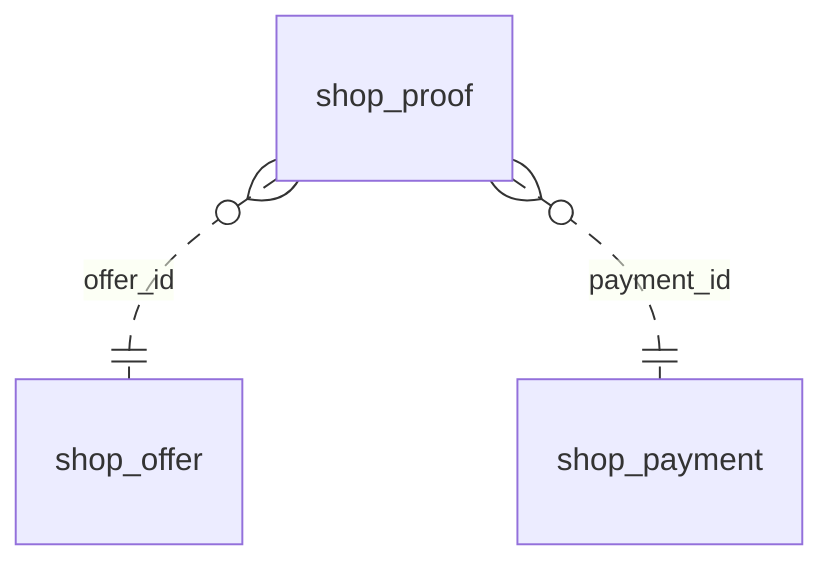

<!-- Generated by integration/db-schema-reference.ts - do not edit. Run: bun run db:docs -->

# `shop_proof`

Source: [src/lib/shop-payment-store.ts](../../../src/lib/shop-payment-store.ts)

## Columns

| Column                | Kind               | Database type              | Nullable | Default | References                             |
| --------------------- | ------------------ | -------------------------- | -------- | ------- | -------------------------------------- |
| `id`                  | UUID (primary key) | `uuid`                     | No       | –       | –                                      |
| `offer_id`            | UUID (foreign key) | `uuid`                     | No       | –       | [`shop_offer`.`id`](shop_offer.md)     |
| `payment_id`          | UUID (foreign key) | `uuid`                     | No       | –       | [`shop_payment`.`id`](shop_payment.md) |
| `source`              | ENUM               | `text`                     | No       | –       | –                                      |
| `chain_id`            | Integer            | `integer`                  | No       | –       | –                                      |
| `tx_hash`             | Free text          | `text`                     | No       | –       | –                                      |
| `log_index`           | Integer            | `integer`                  | Yes      | –       | –                                      |
| `user_op_hash`        | Free text          | `text`                     | Yes      | –       | –                                      |
| `raw_hex`             | Free text          | `text`                     | Yes      | –       | –                                      |
| `transfer_amount`     | Decimal            | `numeric(78,0)`            | Yes      | –       | –                                      |
| `idempotency_key`     | Free text          | `text`                     | No       | –       | –                                      |
| `result`              | ENUM               | `text`                     | Yes      | –       | –                                      |
| `provider_order`      | Free text          | `text`                     | Yes      | –       | –                                      |
| `superseded_by_order` | Free text          | `text`                     | Yes      | –       | –                                      |
| `order_status`        | Free text          | `text`                     | Yes      | –       | –                                      |
| `order_found_at`      | Date/time          | `timestamp with time zone` | Yes      | –       | –                                      |
| `refusal`             | ENUM               | `text`                     | Yes      | –       | –                                      |
| `submit_stopped`      | Boolean            | `boolean`                  | No       | `false` | –                                      |
| `sent_at`             | Date/time          | `timestamp with time zone` | Yes      | –       | –                                      |
| `last_submit_at`      | Date/time          | `timestamp with time zone` | Yes      | –       | –                                      |
| `give_up_at`          | Date/time          | `timestamp with time zone` | No       | –       | –                                      |
| `next_submit_at`      | Date/time          | `timestamp with time zone` | Yes      | –       | –                                      |
| `next_receipt_at`     | Date/time          | `timestamp with time zone` | Yes      | –       | –                                      |
| `next_status_at`      | Date/time          | `timestamp with time zone` | Yes      | –       | –                                      |
| `tries`               | Integer            | `integer`                  | No       | `0`     | –                                      |
| `resolved_at`         | Date/time          | `timestamp with time zone` | Yes      | –       | –                                      |
| `created_at`          | Date/time          | `timestamp with time zone` | No       | –       | –                                      |

## Indexes

| Columns                            | Unique | Where                               | Definition                                                                                                                             |
| ---------------------------------- | ------ | ----------------------------------- | -------------------------------------------------------------------------------------------------------------------------------------- |
| `chain_id`, `tx_hash`, `log_index` | Yes    | `(log_index IS NOT NULL)`           | `CREATE UNIQUE INDEX shop_proof_log_idx ON public.shop_proof USING btree (chain_id, tx_hash, log_index) WHERE (log_index IS NOT NULL)` |
| `chain_id`, `tx_hash`, `offer_id`  | Yes    | `(log_index IS NULL)`               | `CREATE UNIQUE INDEX shop_proof_unlogged_idx ON public.shop_proof USING btree (chain_id, tx_hash, offer_id) WHERE (log_index IS NULL)` |
| `chain_id`, `user_op_hash`         | No     | `(user_op_hash IS NOT NULL)`        | `CREATE INDEX shop_proof_user_op_idx ON public.shop_proof USING btree (chain_id, user_op_hash) WHERE (user_op_hash IS NOT NULL)`       |
| `id`                               | Yes    | –                                   | `CREATE UNIQUE INDEX shop_proof_pkey ON public.shop_proof USING btree (id)`                                                            |
| `next_receipt_at`                  | No     | –                                   | `CREATE INDEX shop_proof_receipt_idx ON public.shop_proof USING btree (next_receipt_at)`                                               |
| `next_status_at`                   | No     | –                                   | `CREATE INDEX shop_proof_status_idx ON public.shop_proof USING btree (next_status_at)`                                                 |
| `next_submit_at`                   | No     | –                                   | `CREATE INDEX shop_proof_submit_idx ON public.shop_proof USING btree (next_submit_at)`                                                 |
| `payment_id`                       | No     | `(superseded_by_order IS NOT NULL)` | `CREATE INDEX shop_proof_superseded_idx ON public.shop_proof USING btree (payment_id) WHERE (superseded_by_order IS NOT NULL)`         |
| `payment_id`                       | Yes    | `(result = 'accepted'::text)`       | `CREATE UNIQUE INDEX shop_proof_payment_accepted_idx ON public.shop_proof USING btree (payment_id) WHERE (result = 'accepted'::text)`  |
| `provider_order`                   | Yes    | `(provider_order IS NOT NULL)`      | `CREATE UNIQUE INDEX shop_proof_order_idx ON public.shop_proof USING btree (provider_order) WHERE (provider_order IS NOT NULL)`        |

## Referenced by

None.

## Relations

