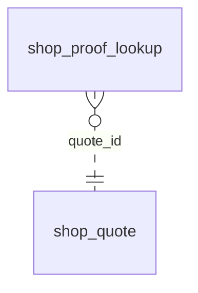

<!-- Generated by integration/db-schema-reference.ts - do not edit. Run: bun run db:docs -->

# `shop_proof_lookup`

Source: [src/lib/shop-payment-store.ts](../../../src/lib/shop-payment-store.ts)

## Columns

| Column        | Kind               | Database type              | Nullable | Default | References                         |
| ------------- | ------------------ | -------------------------- | -------- | ------- | ---------------------------------- |
| `id`          | UUID (primary key) | `uuid`                     | No       | –       | –                                  |
| `quote_id`    | UUID (foreign key) | `uuid`                     | No       | –       | [`shop_quote`.`id`](shop_quote.md) |
| `method`      | Free text          | `text`                     | No       | –       | –                                  |
| `asset`       | Free text          | `text`                     | Yes      | –       | –                                  |
| `chain_id`    | Integer            | `integer`                  | No       | –       | –                                  |
| `hash`        | Free text          | `text`                     | No       | –       | –                                  |
| `next_try_at` | Date/time          | `timestamp with time zone` | No       | –       | –                                  |
| `tries`       | Integer            | `integer`                  | No       | `0`     | –                                  |
| `done_at`     | Date/time          | `timestamp with time zone` | Yes      | –       | –                                  |
| `created_at`  | Date/time          | `timestamp with time zone` | No       | –       | –                                  |

## Indexes

| Columns                        | Unique | Where               | Definition                                                                                                                            |
| ------------------------------ | ------ | ------------------- | ------------------------------------------------------------------------------------------------------------------------------------- |
| `chain_id`, `hash`, `quote_id` | Yes    | –                   | `CREATE UNIQUE INDEX shop_proof_lookup_chain_id_hash_quote_id_key ON public.shop_proof_lookup USING btree (chain_id, hash, quote_id)` |
| `id`                           | Yes    | –                   | `CREATE UNIQUE INDEX shop_proof_lookup_pkey ON public.shop_proof_lookup USING btree (id)`                                             |
| `next_try_at`                  | No     | `(done_at IS NULL)` | `CREATE INDEX shop_proof_lookup_due_idx ON public.shop_proof_lookup USING btree (next_try_at) WHERE (done_at IS NULL)`                |

## Referenced by

None.

## Relations

