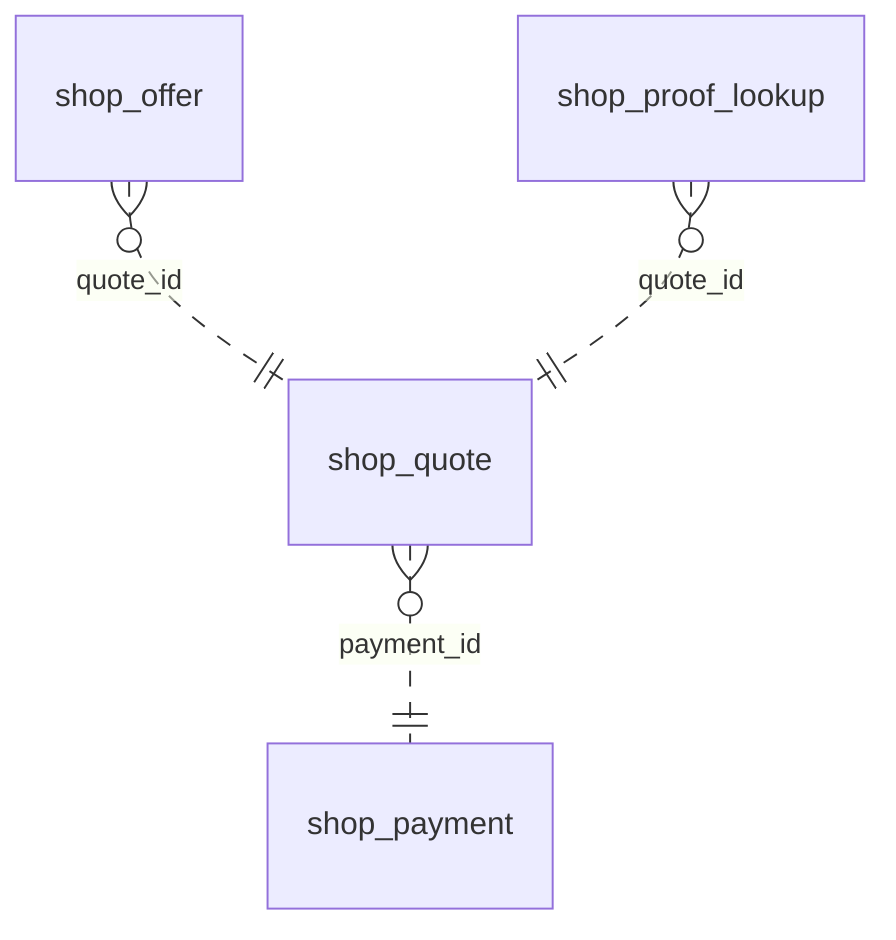

<!-- Generated by integration/db-schema-reference.ts - do not edit. Run: bun run db:docs -->

# `shop_quote`

Source: [src/lib/shop-payment-store.ts](../../../src/lib/shop-payment-store.ts)

## Columns

| Column             | Kind               | Database type              | Nullable | Default | References                             |
| ------------------ | ------------------ | -------------------------- | -------- | ------- | -------------------------------------- |
| `id`               | UUID (primary key) | `uuid`                     | No       | –       | –                                      |
| `payment_id`       | UUID (foreign key) | `uuid`                     | No       | –       | [`shop_payment`.`id`](shop_payment.md) |
| `expires_at`       | Date/time          | `timestamp with time zone` | No       | –       | –                                      |
| `transfer_amounts` | JSON               | `jsonb`                    | No       | –       | –                                      |
| `created_at`       | Date/time          | `timestamp with time zone` | No       | –       | –                                      |

## Indexes

| Columns                    | Unique | Where | Definition                                                                                      |
| -------------------------- | ------ | ----- | ----------------------------------------------------------------------------------------------- |
| `id`                       | Yes    | –     | `CREATE UNIQUE INDEX shop_quote_pkey ON public.shop_quote USING btree (id)`                     |
| `payment_id`, `created_at` | No     | –     | `CREATE INDEX shop_quote_payment_idx ON public.shop_quote USING btree (payment_id, created_at)` |

## Referenced by

| Table               | Column     | Points to |
| ------------------- | ---------- | --------- |
| `shop_offer`        | `quote_id` | `id`      |
| `shop_proof_lookup` | `quote_id` | `id`      |

## Relations

