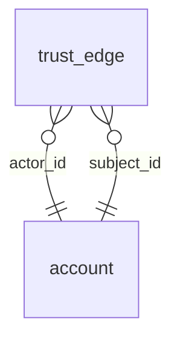

<!-- Generated by integration/db-schema-reference.ts - do not edit. Run: bun run db:docs -->

# `trust_edge`

Source: [src/lib/trust-store.ts](../../../src/lib/trust-store.ts)

## Columns

| Column       | Kind               | Database type              | Nullable | Default | References                   |
| ------------ | ------------------ | -------------------------- | -------- | ------- | ---------------------------- |
| `id`         | UUID (primary key) | `uuid`                     | No       | –       | –                            |
| `subject_id` | UUID (foreign key) | `uuid`                     | No       | –       | [`account`.`id`](account.md) |
| `actor_id`   | UUID (foreign key) | `uuid`                     | No       | –       | [`account`.`id`](account.md) |
| `kind`       | ENUM               | `text`                     | No       | –       | –                            |
| `created_at` | Date/time          | `timestamp with time zone` | No       | –       | –                            |

## Indexes

| Columns              | Unique | Where                                                                                        | Definition                                                                                                                                                                                                   |
| -------------------- | ------ | -------------------------------------------------------------------------------------------- | ------------------------------------------------------------------------------------------------------------------------------------------------------------------------------------------------------------ |
| `actor_id`           | No     | –                                                                                            | `CREATE INDEX trust_edge_actor_idx ON public.trust_edge USING btree (actor_id)`                                                                                                                              |
| `id`                 | Yes    | –                                                                                            | `CREATE UNIQUE INDEX trust_edge_pkey ON public.trust_edge USING btree (id)`                                                                                                                                  |
| `subject_id`, `kind` | Yes    | `(kind = ANY (ARRAY['verify'::text, 'moderator_confirm'::text, 'moderator_appoint'::text]))` | `CREATE UNIQUE INDEX trust_edge_subject_kind_live_uidx ON public.trust_edge USING btree (subject_id, kind) WHERE (kind = ANY (ARRAY['verify'::text, 'moderator_confirm'::text, 'moderator_appoint'::text]))` |

## Referenced by

None.

## Relations

