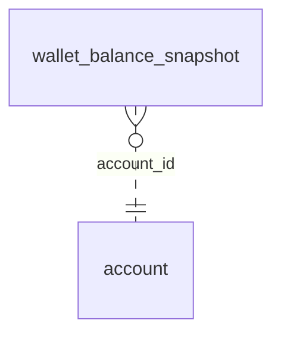

<!-- Generated by integration/db-schema-reference.ts - do not edit. Run: bun run db:docs -->

# `wallet_balance_snapshot`

Source: [src/lib/wallet-store.ts](../../../src/lib/wallet-store.ts)

## Columns

| Column         | Kind               | Database type              | Nullable | Default | References                   |
| -------------- | ------------------ | -------------------------- | -------- | ------- | ---------------------------- |
| `id`           | UUID (primary key) | `uuid`                     | No       | –       | –                            |
| `account_id`   | UUID (foreign key) | `uuid`                     | No       | –       | [`account`.`id`](account.md) |
| `balance_sats` | Integer            | `bigint`                   | No       | –       | –                            |
| `synced_at`    | Date/time          | `timestamp with time zone` | No       | –       | –                            |
| `received_at`  | Date/time          | `timestamp with time zone` | No       | –       | –                            |

## Indexes

| Columns                           | Unique | Where | Definition                                                                                                                                        |
| --------------------------------- | ------ | ----- | ------------------------------------------------------------------------------------------------------------------------------------------------- |
| `account_id`, `received_at`, `id` | No     | –     | `CREATE INDEX wallet_balance_snapshot_account_received_idx ON public.wallet_balance_snapshot USING btree (account_id, received_at DESC, id DESC)` |
| `id`                              | Yes    | –     | `CREATE UNIQUE INDEX wallet_balance_snapshot_pkey ON public.wallet_balance_snapshot USING btree (id)`                                             |

## Referenced by

None.

## Relations

