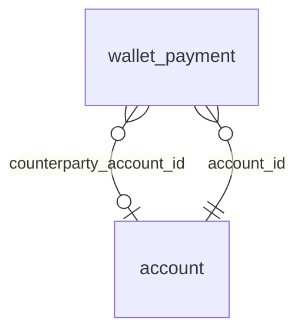

<!-- Generated by integration/db-schema-reference.ts - do not edit. Run: bun run db:docs -->

# `wallet_payment`

Source: [src/lib/wallet-store.ts](../../../src/lib/wallet-store.ts)

## Columns

| Column                    | Kind                    | Database type              | Nullable | Default | References                   |
| ------------------------- | ----------------------- | -------------------------- | -------- | ------- | ---------------------------- |
| `account_id`              | UUID (primary key)      | `uuid`                     | No       | –       | [`account`.`id`](account.md) |
| `payment_id`              | Free text (primary key) | `text`                     | No       | –       | –                            |
| `direction`               | ENUM                    | `text`                     | No       | –       | –                            |
| `status`                  | ENUM                    | `text`                     | No       | –       | –                            |
| `amount_sats`             | Integer                 | `bigint`                   | No       | –       | –                            |
| `fee_sats`                | Integer                 | `bigint`                   | No       | –       | –                            |
| `paid_at`                 | Date/time               | `timestamp with time zone` | No       | –       | –                            |
| `method`                  | Free text               | `text`                     | No       | –       | –                            |
| `payment_hash`            | Free text               | `text`                     | Yes      | –       | –                            |
| `invoice`                 | Free text               | `text`                     | Yes      | –       | –                            |
| `destination`             | Free text               | `text`                     | Yes      | –       | –                            |
| `description`             | Free text               | `text`                     | Yes      | –       | –                            |
| `lnurl_comment`           | Free text               | `text`                     | Yes      | –       | –                            |
| `category`                | ENUM                    | `text`                     | No       | –       | –                            |
| `counterparty_account_id` | UUID (foreign key)      | `uuid`                     | Yes      | –       | [`account`.`id`](account.md) |
| `first_seen_at`           | Date/time               | `timestamp with time zone` | No       | –       | –                            |
| `updated_at`              | Date/time               | `timestamp with time zone` | No       | –       | –                            |
| `last_observed_at`        | Date/time               | `timestamp with time zone` | Yes      | –       | –                            |

## Indexes

| Columns                               | Unique | Where | Definition                                                                                                                      |
| ------------------------------------- | ------ | ----- | ------------------------------------------------------------------------------------------------------------------------------- |
| `account_id`, `paid_at`, `payment_id` | No     | –     | `CREATE INDEX wallet_payment_account_paid_idx ON public.wallet_payment USING btree (account_id, paid_at DESC, payment_id DESC)` |
| `account_id`, `payment_id`            | Yes    | –     | `CREATE UNIQUE INDEX wallet_payment_pkey ON public.wallet_payment USING btree (account_id, payment_id)`                         |

## Referenced by

None.

## Relations

