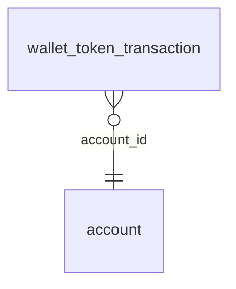

<!-- Generated by integration/db-schema-reference.ts - do not edit. Run: bun run db:docs -->

# `wallet_token_transaction`

Source: [src/lib/wallet-store.ts](../../../src/lib/wallet-store.ts)

## Columns

| Column                   | Kind                    | Database type              | Nullable | Default | References                   |
| ------------------------ | ----------------------- | -------------------------- | -------- | ------- | ---------------------------- |
| `account_id`             | UUID (primary key)      | `uuid`                     | No       | –       | [`account`.`id`](account.md) |
| `wallet_pubkey`          | Free text (primary key) | `text`                     | No       | –       | –                            |
| `transaction_hash`       | Free text (primary key) | `text`                     | No       | –       | –                            |
| `token_identifier`       | Free text               | `text`                     | Yes      | –       | –                            |
| `direction`              | ENUM                    | `text`                     | No       | –       | –                            |
| `amount`                 | Decimal                 | `numeric(39,0)`            | No       | –       | –                            |
| `counterparty_pubkeys`   | Array of text           | `text[]`                   | No       | –       | –                            |
| `type`                   | ENUM                    | `text`                     | No       | –       | –                            |
| `status`                 | ENUM                    | `text`                     | No       | –       | –                            |
| `transaction_created_at` | Date/time               | `timestamp with time zone` | Yes      | –       | –                            |
| `transaction_expiry_at`  | Date/time               | `timestamp with time zone` | Yes      | –       | –                            |
| `first_seen_at`          | Date/time               | `timestamp with time zone` | No       | –       | –                            |
| `last_seen_at`           | Date/time               | `timestamp with time zone` | No       | –       | –                            |

## Indexes

| Columns                                                                     | Unique | Where | Definition                                                                                                                                                                           |
| --------------------------------------------------------------------------- | ------ | ----- | ------------------------------------------------------------------------------------------------------------------------------------------------------------------------------------ |
| `account_id`, `wallet_pubkey`, `transaction_created_at`, `transaction_hash` | No     | –     | `CREATE INDEX wallet_token_transaction_wallet_created_idx ON public.wallet_token_transaction USING btree (account_id, wallet_pubkey, transaction_created_at DESC, transaction_hash)` |
| `account_id`, `wallet_pubkey`, `transaction_hash`                           | Yes    | –     | `CREATE UNIQUE INDEX wallet_token_transaction_pkey ON public.wallet_token_transaction USING btree (account_id, wallet_pubkey, transaction_hash)`                                     |

## Referenced by

None.

## Relations

