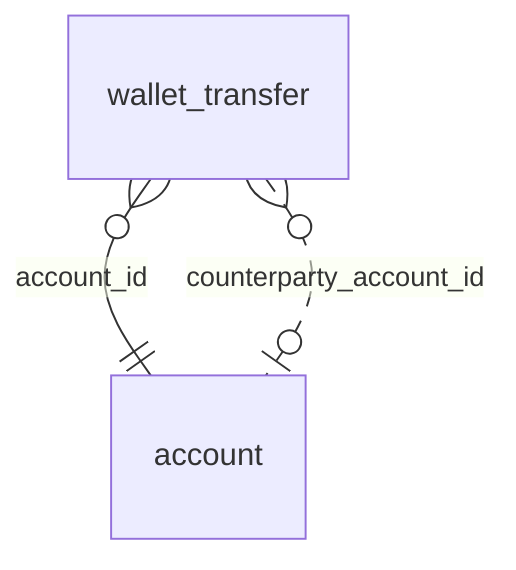

<!-- Generated by integration/db-schema-reference.ts - do not edit. Run: bun run db:docs -->

# `wallet_transfer`

Source: [src/lib/wallet-store.ts](../../../src/lib/wallet-store.ts)

## Columns

| Column                    | Kind                    | Database type              | Nullable | Default | References                   |
| ------------------------- | ----------------------- | -------------------------- | -------- | ------- | ---------------------------- |
| `account_id`              | UUID (primary key)      | `uuid`                     | No       | –       | [`account`.`id`](account.md) |
| `wallet_pubkey`           | Free text (primary key) | `text`                     | No       | –       | –                            |
| `transfer_id`             | Free text (primary key) | `text`                     | No       | –       | –                            |
| `direction`               | ENUM                    | `text`                     | No       | –       | –                            |
| `type`                    | ENUM                    | `text`                     | No       | –       | –                            |
| `status`                  | ENUM                    | `text`                     | No       | –       | –                            |
| `amount_sats`             | Integer                 | `bigint`                   | No       | –       | –                            |
| `counterparty_pubkey`     | Free text               | `text`                     | No       | –       | –                            |
| `counterparty_account_id` | UUID (foreign key)      | `uuid`                     | Yes      | –       | [`account`.`id`](account.md) |
| `spark_invoice`           | Free text               | `text`                     | Yes      | –       | –                            |
| `transfer_created_at`     | Date/time               | `timestamp with time zone` | Yes      | –       | –                            |
| `transfer_updated_at`     | Date/time               | `timestamp with time zone` | Yes      | –       | –                            |
| `first_seen_at`           | Date/time               | `timestamp with time zone` | No       | –       | –                            |
| `last_seen_at`            | Date/time               | `timestamp with time zone` | No       | –       | –                            |

## Indexes

| Columns                                                             | Unique | Where                                                                                                                                  | Definition                                                                                                                                                                                                                                                                                        |
| ------------------------------------------------------------------- | ------ | -------------------------------------------------------------------------------------------------------------------------------------- | ------------------------------------------------------------------------------------------------------------------------------------------------------------------------------------------------------------------------------------------------------------------------------------------------- |
| `account_id`, `(expression)`                                        | No     | `((direction = 'out'::text) AND (status = 'completed'::text) AND (type = 'transfer'::text) AND (counterparty_account_id IS NOT NULL))` | `CREATE INDEX wallet_transfer_shop_payment_idx ON public.wallet_transfer USING btree (account_id, COALESCE(transfer_updated_at, transfer_created_at)) WHERE ((direction = 'out'::text) AND (status = 'completed'::text) AND (type = 'transfer'::text) AND (counterparty_account_id IS NOT NULL))` |
| `account_id`, `wallet_pubkey`, `transfer_created_at`                | No     | `(status = 'pending'::text)`                                                                                                           | `CREATE INDEX wallet_transfer_pending_idx ON public.wallet_transfer USING btree (account_id, wallet_pubkey, transfer_created_at) WHERE (status = 'pending'::text)`                                                                                                                                |
| `account_id`, `wallet_pubkey`, `transfer_created_at`, `transfer_id` | No     | –                                                                                                                                      | `CREATE INDEX wallet_transfer_wallet_created_idx ON public.wallet_transfer USING btree (account_id, wallet_pubkey, transfer_created_at DESC, transfer_id)`                                                                                                                                        |
| `account_id`, `wallet_pubkey`, `transfer_id`                        | Yes    | –                                                                                                                                      | `CREATE UNIQUE INDEX wallet_transfer_pkey ON public.wallet_transfer USING btree (account_id, wallet_pubkey, transfer_id)`                                                                                                                                                                         |
| `counterparty_account_id`                                           | No     | `(counterparty_account_id IS NOT NULL)`                                                                                                | `CREATE INDEX wallet_transfer_counterparty_idx ON public.wallet_transfer USING btree (counterparty_account_id) WHERE (counterparty_account_id IS NOT NULL)`                                                                                                                                       |

## Referenced by

None.

## Relations

