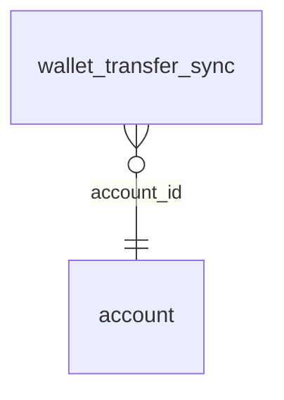

<!-- Generated by integration/db-schema-reference.ts - do not edit. Run: bun run db:docs -->

# `wallet_transfer_sync`

Source: [src/lib/wallet-store.ts](../../../src/lib/wallet-store.ts)

## Columns

| Column              | Kind                    | Database type              | Nullable | Default | References                   |
| ------------------- | ----------------------- | -------------------------- | -------- | ------- | ---------------------------- |
| `account_id`        | UUID (primary key)      | `uuid`                     | No       | –       | [`account`.`id`](account.md) |
| `wallet_pubkey`     | Free text (primary key) | `text`                     | No       | –       | –                            |
| `last_full_sync_at` | Date/time               | `timestamp with time zone` | No       | –       | –                            |

## Indexes

| Columns                       | Unique | Where | Definition                                                                                                             |
| ----------------------------- | ------ | ----- | ---------------------------------------------------------------------------------------------------------------------- |
| `account_id`, `wallet_pubkey` | Yes    | –     | `CREATE UNIQUE INDEX wallet_transfer_sync_pkey ON public.wallet_transfer_sync USING btree (account_id, wallet_pubkey)` |

## Referenced by

None.

## Relations

