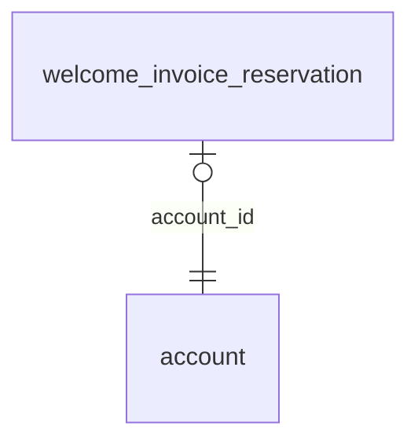

<!-- Generated by integration/db-schema-reference.ts - do not edit. Run: bun run db:docs -->

# `welcome_invoice_reservation`

Source: [src/lib/welcome-reservation.ts](../../../src/lib/welcome-reservation.ts)

## Columns

| Column           | Kind               | Database type              | Nullable | Default | References                   |
| ---------------- | ------------------ | -------------------------- | -------- | ------- | ---------------------------- |
| `account_id`     | UUID (primary key) | `uuid`                     | No       | –       | [`account`.`id`](account.md) |
| `reservation_id` | Free text          | `text`                     | No       | –       | –                            |
| `created_at`     | Date/time          | `timestamp with time zone` | No       | –       | –                            |
| `expires_at`     | Date/time          | `timestamp with time zone` | No       | –       | –                            |

## Indexes

| Columns          | Unique | Where | Definition                                                                                                                              |
| ---------------- | ------ | ----- | --------------------------------------------------------------------------------------------------------------------------------------- |
| `account_id`     | Yes    | –     | `CREATE UNIQUE INDEX welcome_invoice_reservation_pkey ON public.welcome_invoice_reservation USING btree (account_id)`                   |
| `reservation_id` | Yes    | –     | `CREATE UNIQUE INDEX welcome_invoice_reservation_reservation_id_key ON public.welcome_invoice_reservation USING btree (reservation_id)` |

## Referenced by

None.

## Relations

